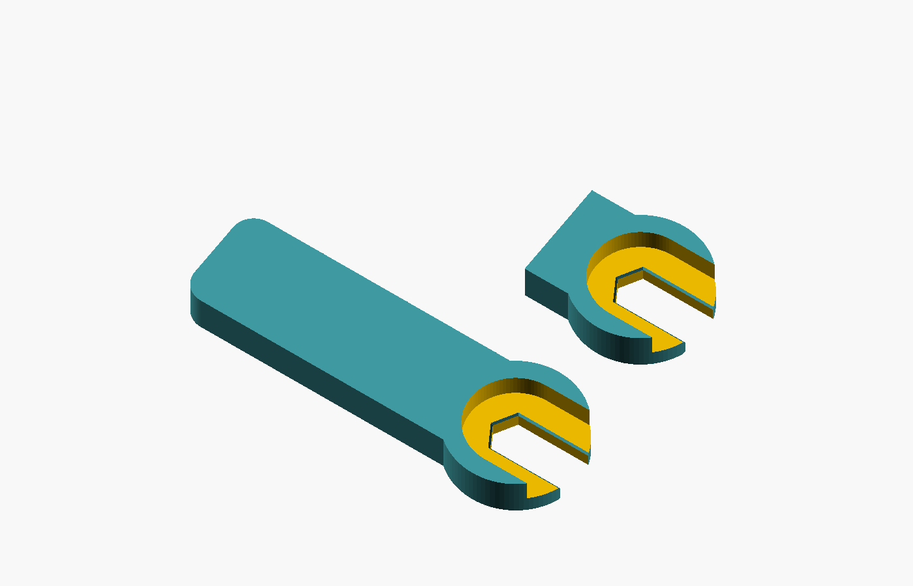

# Clevis threading grip

A parametric bench tool for holding the gripping flats of one loose nylon clevis while starting a compatible pushrod. The open jaw releases sideways; the relief above the short contact band leaves room for the arms, pin and keeper. It is used on disconnected spare parts and removed before installation.



The user approved a prototype using a common clevis for medium-sized applications. The reference class is a standard 2-56 nylon clevis, such as the [DU-BRO standard Nylon Kwik-Link](https://www.dubro.com/products/nylon-kwik-links). The manufacturer confirms the rod class but supplies no across-flat or usable-flat-length dimensions on that page. The dimensions below are editable examples, not a verified DU-BRO, Great Planes or Timber X fit. 2-56 specifies a thread, not the outside gripping profile. M2 and 2-56 fittings are not interchangeable merely because they look similar.

## Parts and dimensions

Open `clevis-threading-grip.scad`. Set `part` to `grip`, `contact_coupon` or `layout`. The coupon is an intersection of the same full geometry, preserving its jaw, chamfers and upper relief. Print the coupon before the full handle.

| Parameter | Example, mm | Meaning |
| --- | ---: | --- |
| `flat_spacing` | 5.5 | Actual clevis body across the intended gripping flats |
| `flat_clearance` | 0.15 | Allowance per flat; nominal jaw opening is 5.8 |
| `contact_depth` | 2.4 | Axial band that touches only the gripping body |
| `entry_chamfer` | 0.25 | Small planar lead-in on each face |
| `arm_clearance_radius` | 6.5 | Required arm/pin/keeper envelope including allowance |
| `head_radius` | 9 | Outside radius of jaw head |
| `handle_length` | 44 | Clevis axis to far handle end |
| `handle_width` / `handle_thickness` | 14 / 5.5 | Rear handle envelope |
| `minimum_wall` | 1.8 | Minimum retained radial wall and jaw web |
| `coupon_back` | 12 | Crop behind axis for the contact sample |

The default grip is approximately 52.5 × 18 × 5.5 mm. Clevis and pushrod run along Z. The hex base fits between the flats in XY; hold the fitting still and slide the tool off toward -X. Equivalently, the fitting exits toward +X relative to the tool. Keep the gripping band within the usable body length. The larger circular relief above it opens toward +X too, so it does not form a closed collar around the assembled fitting. There is no wrench-drive hole or clamping mechanism.

Before selecting dimensions, check the actual spare fitting's flats, taper, usable length, arm/pin/keeper envelope and full side-removal path. The relief envelope is a clearance requirement to check, not a claim that all clevis arms fit. If the body is round, lacks suitable flats or cannot release without spreading its arms, this version is unsuitable. Do not force a near fit.

## Printing and first use

Suggested starting settings for a coupon: PLA, 0.16–0.20 mm layers, 0.4 mm nozzle, four walls and 30–40% infill. PETG is an alternative for the full bench prototype. Use the flat Z=0 face on the bed. The geometry has a flat base and an open relief above it; inspect the sliced bridges, thin walls, first-layer expansion and jaw finish before deciding whether supports are needed. These settings have not been sliced or printed here. Neither material is assumed soft, nonmarring or strong enough for a particular torque.

1. Compare fingers, a fitting-maker-approved wrench and an existing clevis threading tool first. A larger handle must never justify forcing a reluctant thread.
2. Test the coupon on a replaceable spare clevis off the aircraft. It should seat with finger pressure, touch only the intended flats and leave the thread start visible. Confirm arm/pin/keeper clearance and side removal with the matching pushrod present.
3. Reject wedging, slipping, unexpected resistance, marks, whitening, abrasion, debris, cracks or distortion. Inspect the fitting and tool before and after. Keep uncertain or damaged trial parts out of flight use.
4. Print the full grip only after the coupon fits. Repeat the checks, then compare ten whole-task trials per method using comparable fresh specimens and alternating order. Include retrieval, seating, threading, release, inspection and put-away. Use separate spare specimens for preliminary thread checks and timed first-threading trials. Reusing nylon threads changes the test.
5. Use separate spares for twenty further seating/removal cycles and inspect wear. Record fabrication and first-use effort separately from recurring time. Follow the fitting manufacturer's assembly endpoint and inspection procedure; these checks do not establish thread engagement, control settings or airworthiness.

An existing [DU-BRO E/Z Threader](https://www.dubro.com/products/e-z-threader) may already solve the task. The [Vista Grande manual, page 12](https://www.towerhobbies.com/on/demandware.static/-/Sites-horizon-master/default/dwd44c21d0/Manuals/TOWA2045_Manual_EN.pdf) documents awkward clevis threading and recommends a commercial tool. No speed, damage-prevention or usefulness benefit has been demonstrated for this print.

## Exporting and local validation

From the repository root:

```sh
mkdir -p projects/clevis-threading-grip/exports
openscad --export-format asciistl -D 'part="contact_coupon"' -o projects/clevis-threading-grip/exports/contact-coupon.stl projects/clevis-threading-grip/clevis-threading-grip.scad
openscad --export-format asciistl -D 'part="grip"' -o projects/clevis-threading-grip/exports/grip.stl projects/clevis-threading-grip/clevis-threading-grip.scad
python3 projects/clevis-threading-grip/validate.py
python3 -B -m unittest discover -s projects/clevis-threading-grip -p 'test_*.py'
```

Use `--openscad /path/to/OpenSCAD` to choose the executable, and `--output-dir /new/evidence/directory` to retain exports, logs and `summary.json` at a known location. Without it, the validator prints its new temporary evidence directory. Existing directories are refused to prevent stale exports being mistaken for new results. Generated STL files remain ignored.

The validator uses the existing cassette renderer adapter and shared strict mesh/ray helpers unchanged. It checks default, smaller, larger and closer-fit grip/coupon exports; closed, connected, consistently wound finite positive-volume meshes; actual jaw flats, hex back, contact depth, entry chamfers, upper relief, side-release corridors and coupon surface agreement. Invalid dimensions must raise the named assertion. Wrong functional dimensions and actual blocked-mouth, blocked-relief and narrowed upper-exit substitute meshes must be rejected. Source hashes must remain unchanged during the run.

Renderer warnings/errors, missing or malformed exports and the existing adapter's 180-second case timeout fail the run. A zero renderer exit does not override diagnostics. Once rendering begins, failed cases and dependent checks remain in `summary.json`, and the command exits nonzero. Missing executables or an unusable/existing evidence directory fail before rendering. Local CAD results do not establish slicer behavior, printed fit, contact force, grip, damage, wear or usefulness.
