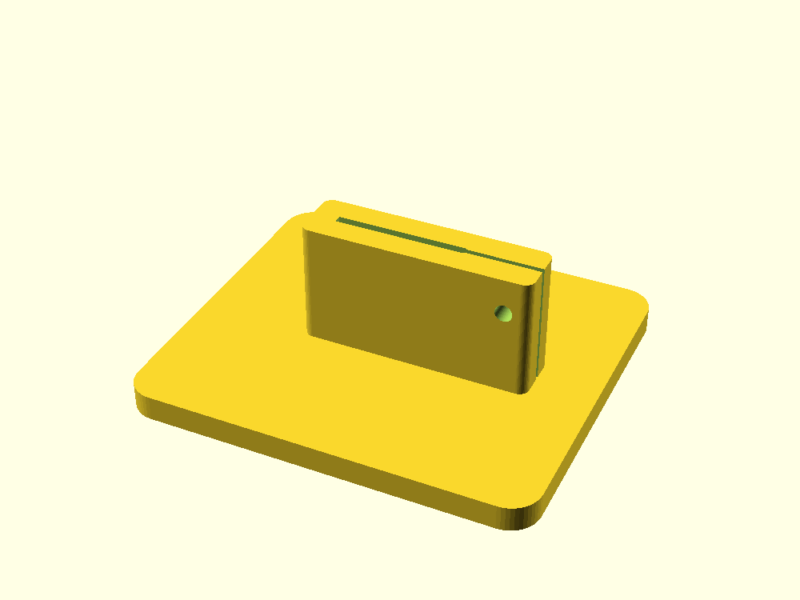
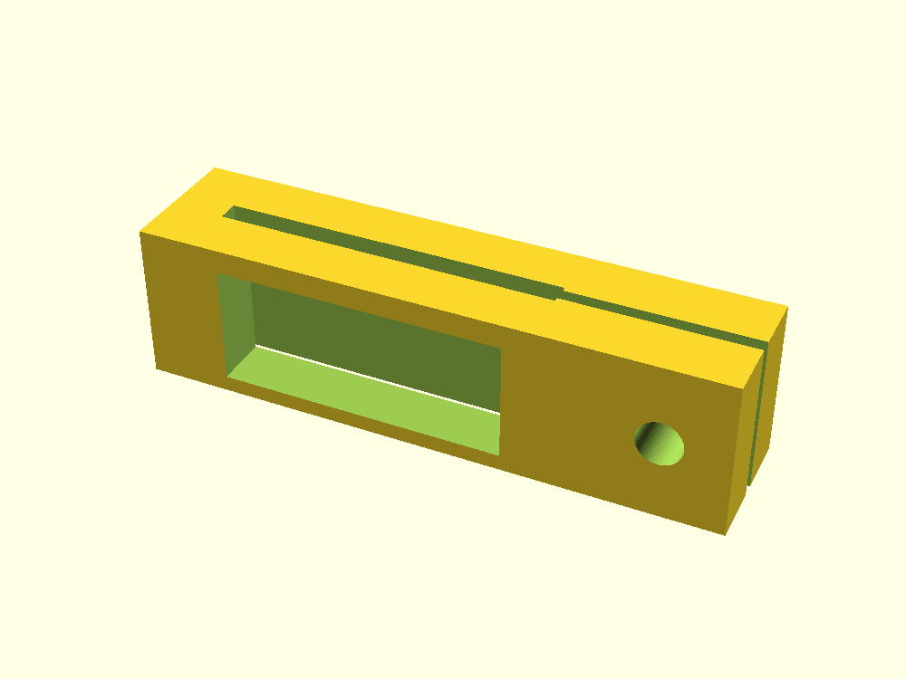

# Control-throw ruler holder

A bench foot holds one metal ruler vertically while a separate cursor marks neutral. The foot and cursor use screws across split ears beyond the ruler's right edge. Tightening pulls the printed jaws together; neither screw tip contacts the ruler. The aircraft needs its own stable support. The ruler supplies the scale; the print has no graduations.

**Defaults are editable example dimensions, not measurements or a fit claim.** Measure the actual ruler, hardware, aircraft station and bench setup. No ruler fit, clamp force, accuracy, repeatability, aircraft clearance or physical usefulness has been established.

## Source and example geometry

- `control-throw-ruler-holder.scad`: parameters at top; `part` selects `foot`, `cursor` or `socket_coupon`.
- `cursor.scad` and `socket-coupon.scad`: same-source export wrappers. All `-D` dimension overrides also apply to these wrappers.
- `exports/`: ignored regenerated meshes.

All dimensions are millimeters. The example ruler is 25 wide, 1 thick and 150 long. The foot is 80 × 70 × 5; its socket is 24 high above the foot, with 0.30 clearance on each side of the ruler section. The cursor is 12 high with 0.35 clearance per side. Example bolt bores are 3.4; rear hex pockets are 5.8 across flats and 2.7 deep. Pocket dimensions include whatever clearance you choose; they are not nominal hardware dimensions.

The readable scale faces **-Y** (the front, screw-head side). The cursor's front window is 21.7 wide and 9 high. Its lower horizontal window edge is the reference, 1.2 above the cursor bottom. The edge rails hide approximately 2 mm on either side and the front beams hide the ruler above and below the window. Choose a ruler whose readable graduations lie in the window; reject this cursor if the chosen scale is obscured. The rear wall covers the back scale. Read from the same front side every time.

The socket is fixed perpendicular to the foot; there is no adjustable angle or mast. Default `minimum_ruler_engagement=16` allows at most 8 mm of lift from the socket floor. Confirm the actual insertion with a ruler or removable mark before tightening; CAD cannot enforce insertion. The socket can hide the lowest 24 mm of the ruler when seated. `minimum_exposed_scale` only checks the length remaining above the modeled socket; it cannot know the ruler's zero position or graduation placement. Neutral and both endpoints must be visible at the manual's measurement station. If this range or insertion cannot be achieved, reconsider the setup before printing a complete tool.

The slot-to-split junction has a 0.02 mm transition bevel outside the ruler envelope to avoid collinear STL floor facets. It is a modeling relief, not a fit tolerance.

The coupon contains the exact full socket, split ears, screw bore and rear nut pocket, on a reduced 49.6 × 15.6 × 3 base. It checks ruler passage and socket hardware without printing the full foot. Print the separate cursor alongside it to check its actual window, fit and screw capture; the socket coupon does not substitute for a cursor trial.

## Exports

From the repository root, with OpenSCAD on PATH:

```sh
openscad -o projects/control-throw-ruler-holder/exports/foot.stl projects/control-throw-ruler-holder/control-throw-ruler-holder.scad
openscad -o projects/control-throw-ruler-holder/exports/cursor.stl projects/control-throw-ruler-holder/cursor.scad
openscad -o projects/control-throw-ruler-holder/exports/socket-coupon.stl projects/control-throw-ruler-holder/socket-coupon.scad
```

On this Mac, replace `openscad` with `"/Applications/OpenSCAD-2021.01.app/Contents/MacOS/OpenSCAD"` if it is not on PATH. For example, measured overrides can be applied together:

```sh
openscad -D 'ruler_width=30' -D 'ruler_thickness=1.5' -D 'ruler_length=200' -D 'socket_clearance=0.25' -D 'cursor_clearance=0.25' -D 'split_gap=0.8' -o projects/control-throw-ruler-holder/exports/measured-foot.stl projects/control-throw-ruler-holder/control-throw-ruler-holder.scad
```

Changing dimensions can require new base, wall or ear dimensions. Use the same measured overrides for every part. `show_reference=true` adds a transparent rectangular ruler in preview; background geometry is excluded from STL. It represents no actual graduations, cursor position or aircraft envelope.

## Print and assemble

PLA is a candidate for a first cool indoor coupon; PETG is an alternative to evaluate for handling and flexing. Start at 0.2 mm layer height, four walls and 35% infill. Print each part with its flat base/bottom on the bed, socket/cursor vertical. These settings are starting points, not strength or creep ratings. No supports are intended, but inspect the horizontal screw bores, nut pockets, cursor front-window roof and narrow reference edge in the slicer. Test bridging or use removable supports that leave the apertures and split clear. Do not scale meshes in the slicer; edit source parameters for fit.

Use two measured thumb screws with matching hex nuts, one per part, and non-slip pads under the foot if needed. M3 hardware is an example only. With these geometry defaults, head-seat to rear-face distances are 11.6 for the foot/coupon and 10.1 for the cursor; the nut occupies the outermost 2.7. Choose actual screw lengths for full nut engagement and acceptable rear projection, accounting for washers and head/shoulder shape. Confirm thumb-head clearance, nut entry and tools by hand with the coupons. Nut pockets are rear-open for insertion; the screw retains the nut after assembly. The hex pocket restrains rotation but is not a snap fit.

Back the screws off before inserting the ruler. Tighten only enough to prevent drift. The printed inner jaw faces distribute contact; no screw should touch the ruler or its scale. Inspect these faces and remove rough burrs before use. The cursor's narrow front contacts can still mark coatings or hide edge graduations, and stiff jaws may close poorly: reject a fit that needs force or excessive torque. Do not rely on the design assertions as proof of useful spring action. Keep hardware and the cursor clear of the full control-surface sweep. Fit the cursor over a free ruler end; this version does not snap onto an installed ruler.

## Validation and acceptance

For CAD validation, use actual OpenSCAD exports of all three parts, closed/connected mesh checks, representative valid and rejected parameters, section/point probes and preview inspection. Ordinary unit tests would not establish these geometry properties. Assertions cover positive ruler dimensions, slot/split compatibility, walls behind nut pockets, screw/nut margins, engagement, exposed ruler length, base support and the cursor's reference/window material.

Useful valid cases include defaults for all three selectors; a 30 × 1.5 × 200 ruler with both clearances 0.25 and split 0.8; and `socket_engagement=32`, `socket_screw_height=23`. Meaningful rejected cases include `socket_wall=3` (nut pocket wall), `split_gap=2` (slot closure), `socket_clearance=0.75` (jaws would exhaust the split before touching the ruler), `socket_engagement=20` (screw margin), `minimum_ruler_engagement=8` (insertion below clamping station), `ruler_length=90` (exposed scale), `cursor_reference_offset=0.5` (reference edge), `ear_extension=6` (nut surround), `screw_hole_diameter=4` (nut capture) and an unknown selector. The split must accommodate twice the greater per-side clearance with some gap remaining when the jaws contact the ruler. Rounded blocks also require width and depth greater than twice their corner radius, so thin dimensions cannot silently erase the socket. Invalid CSG exports can return exit code zero in OpenSCAD; check the intended assertion message in diagnostics as well as the output.

Thin-socket regression overrides are `minimum_wall=1`, `nut_depth=0.8`, `socket_wall=1.8`, `cursor_wall=1.8`, `nut_across_flats=3`, `screw_hole_diameter=1`, `ruler_thickness=0.2`, both clearances `0.05`, and `split_gap=0.2`. With `socket_corner_radius=2`, both foot and socket coupon must reject the nonpositive inner profile. With radius `1`, both must export complete sockets. These are CAD boundary checks, not recommended hardware dimensions.

1. Compare a wood block or existing clamp holding the same ruler first. Keep that simpler setup if it is equally stable and convenient.
2. Measure ruler section/length/flatness, scale side/zero/graduations, nuts/screws/head envelopes, prescribed measurement station, neutral height, full travel, bench slope, viewing direction and clearances. Agree a reading-repeatability target before trials.
3. Print the socket coupon and cursor. Confirm smooth passage, minimum insertion, full nut engagement, gentle clamping, visible graduations, clear split gaps and no contact marks. Perform twenty loosen/slide/tighten cycles and inspect threads, nut capture, jaw deformation and cursor slip.
4. Inspect the full foot's toolpath and print one set. Follow the actual aircraft manual's setup and propulsion-disable procedure. Secure the aircraft separately, check perpendicularity to the prescribed displacement direction, and check that neutral and both endpoints remain visible with no surface contact.
5. Run ten remove/place/reset trials against an independently secured ruler and the wood-block/clamp baseline with the same aircraft support. Record neutral and endpoint readings, base drift, ruler lean and cursor slip. Subtract neutral numerically to cross-check the cursor; report bias and range separately from accuracy.
6. Continue only if the print reduces reference shifts or improves hands-free readings without introducing contact or obscured scale. Inspect screw loading, pads, marks and creep at the actual indoor temperature. Remove the tool before flight.

CAD checks cannot replace slicer inspection, actual ruler/hardware fit, strength, printed clamp action or recorded physical trials. The [merged design brief](../../docs/proposals/2026-10-10-control-throw-ruler-holder.md) gives the task rationale and measurement unknowns. This prototype omits aircraft attachment, printed scales, masts, electronics and angle conversion.

## Rendered preview




