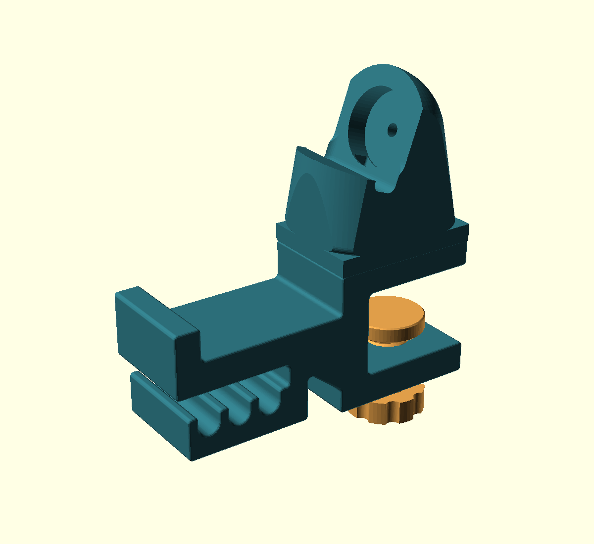
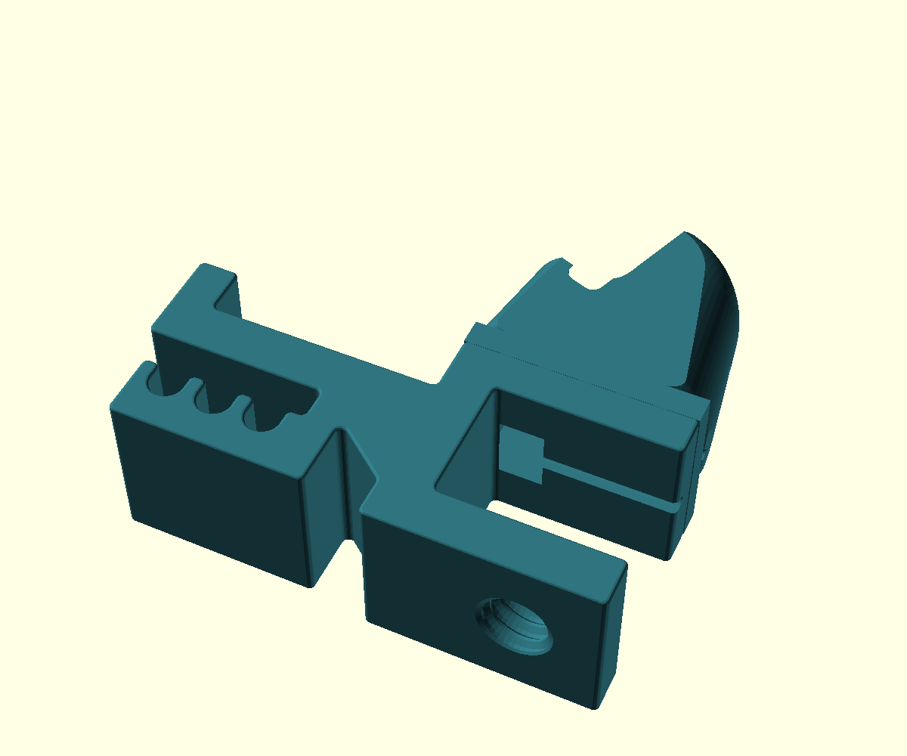

# Headphone clamp with Apple Watch charging stand

A second version for a **21.5 mm desktop**, with a watch stand built into the top jaw. The original headphone-only version remains in `../desk-headphone-hook/`.



The body, screw and pressure shoe are printable. The charger itself is your existing hardware. This version retains the broad headphone saddle, retaining lip and three underside cable grooves, with their entrance facing outward away from the clamp.

## What changed

The top jaw is now 16 mm thick and supports the watch stand. The stand's exterior is trimmed to the clamp's approximately 40 mm width and 56 mm top-jaw depth. Its circular charger pocket, tilt, support notch and internal tunnel come directly from your supplied `apple-watch-stand-big-usb.stl`. You confirmed that the reference already fits your watch and charger. The functional head was not scaled or remodeled.

| Feature | Dimension |
|---|---:|
| Intended desk thickness | 21.5 mm |
| Body width | 39.95 mm |
| Body size in supplied print orientation | 121.97 × 116.24 × 39.95 mm |
| Stand top above desktop | 72.77 mm |
| Top jaw thickness | 16 mm |
| Charger pocket diameter, measured from reference | 28.5 mm |
| Charger pocket depth along its axis | 8 mm |
| Watch notch internal width | 34 mm |
| Charger face tilt from vertical | 20° |
| Added USB opening through top jaw | 15 × 16 mm |
| Added rear cable groove | 3.6 mm |
| Head-fit sample size | 54.54 × 39.82 × 39.95 mm |

The watch faces outward over the headphone side. The assembly extends approximately 62 mm below the desk, including the knob. Allow about 42 mm of unobstructed desk above and below its edge. Desk aprons, edge bevels and nearby objects still need a real fit check.

## Files and printing

Print one each of `exports/body.stl`, `exports/screw.stl` and `exports/shoe.stl`. The screw and shoe are identical to version 1 and can be reused if you already printed them.

The body STL is already **lying on its broad side**, with the clamp's C-shaped profile in the bed plane. This puts the arm and jaw outlines within the layers. The integrated stand shares that orientation; no separate watch-stand attachment is required.



Print the small samples first:

- `exports/watch-fit-sample.stl` retains the full charger pocket and watch notch in the new side-print orientation. It omits the lower base, so it tests head fit, not the complete USB route or desk clamp.
- `exports/thread_sample.stl` and `exports/screw_sample.stl` test the reused printed thread. The female sample has the same horizontal thread axis as the body. The screw must turn through it by hand without forcing it.

Use the version 1 starting settings: PETG, 0.4 mm nozzle, 0.20 mm layers, six walls, six top/bottom layers, 40% infill for the body and solid screw/shoe. These are starting settings, not a tested profile. Inspect the sliced pocket, notch, USB tunnel and horizontal thread. Side printing can require local supports; this design is **not verified support-free**. Avoid inaccessible support inside the thread or tunnel, and check the samples before committing to the body. Do not scale the model to correct fit.

## Charger installation and mounting

1. Install the charger **before mounting the clamp on the desk**. Feed its USB connector through the stand's existing tunnel and the new through-opening in the top jaw. Seat the puck as in your fitted reference stand.
2. Run the thin cable through the open groove under the top jaw and out the rear, toward the desk. The groove joins the USB opening. Check that the cable sits inside it without being pinched against the desktop. The connector does not need to pass through the narrow rear groove.
3. Thread the screw into the lower jaw. Put the loose pressure shoe on its tip, with the broad flat face toward the desk underside.
4. Slide the clamp over the 21.5 mm edge, keeping the desk edge approximately 3 mm clear of the inner back corner. Tighten gently by hand until secure.
5. Fit the watch and headphones together and check band, cable and hand clearance. Feed headphone cables into the three lower grooves from their outward-facing entrance.

The pressure shoe is not captured; hold it while mounting or removing the holder. Clean and smooth desk-contact surfaces before use. Check for surface marks and cable pinching during the first trial.

## Validation and limits

Fourteen local checks passed: six printable meshes are closed, consistently wound, connected and placed on the bed; three assembly checks found no solid overlap with the desk, screw or shoe; two Boolean comparisons found no removed or added material around the reference charger pocket and support notch; and three passage checks verified the added USB opening, rear cable groove and outward headphone-cable entry.

The USB probe is a conservative 14.5 × 6.3 mm rectangular envelope through the new jaw and into the original aperture. The supplied aperture has rounded corners. This probe is not a measurement of your connector and does not simulate feeding a rigid plug through the full curved tunnel. The rear groove clears a 3 mm circular cable envelope; the headphone route clears a 6 mm circular cable envelope.

Interface comparisons use the composed source solid against the original reference inside a region enclosing the pocket and notch. Clearance checks use the exported body. Reference meshes and reused hardware were also checked byte-for-byte against the supplied stand and version 1 exports. Results and hashes are in `exports/validation.json`.

Your known-fitting reference supports the interface dimensions, but the new print orientation, clamp fit, charging operation, support removal, combined load and long-term creep remain physically untested. Test the samples, then the assembled holder over a soft surface with a sacrificial load before using it for your watch and headphones. There is no rated load.

## Editable source and provenance

Open `desk-headphone-hook-watch.scad` in OpenSCAD. Keep its `reference/` and `exports/` folders beside it: the source composes local STL inputs, and the assembly preview loads the screw and shoe. Select `part="body"` or `part="watch_fit_sample"` to export those parts. This version is fixed to the version 1 default clamp; changing its dimensions requires regenerating that base, updating its frozen mesh and rechecking this integration.

`reference/apple-watch-stand-big-usb.stl` is an unchanged local copy of the file you supplied from Downloads. Its author and license were not supplied. `reference/headphone-hook-body.stl` is a frozen copy of the original headphone-only design from this conversation; that project's README records the original hook inspiration.

OpenSCAD 2021.01 was used for the exports. Example from this folder:

```sh
/Applications/OpenSCAD-2021.01.app/Contents/MacOS/OpenSCAD \
  --export-format asciistl -D 'part="body"' \
  -o exports/body.stl desk-headphone-hook-watch.scad
```

Within the repository, run `python3 projects/desk-headphone-hook-watch/validate.py` to recheck existing exports and the composed interfaces. Regenerate changed printable parts first. The validator uses the repository's shared mesh checker; the ZIP contains the completed report rather than this repository-dependent tool.
