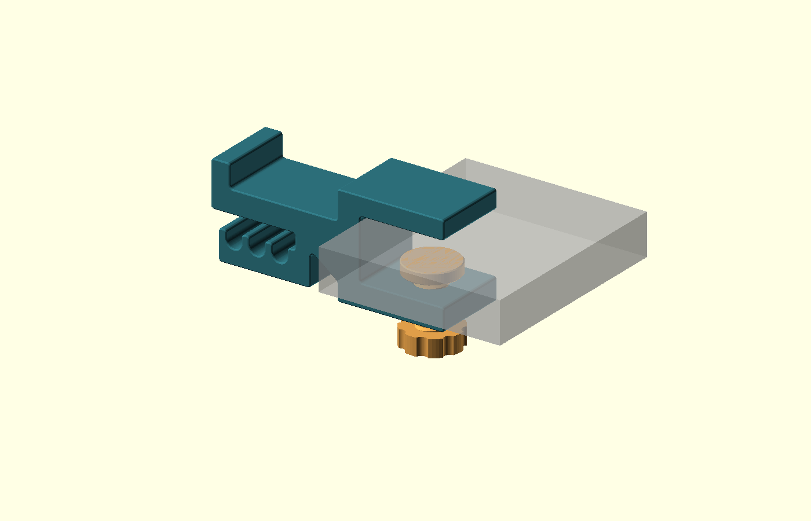
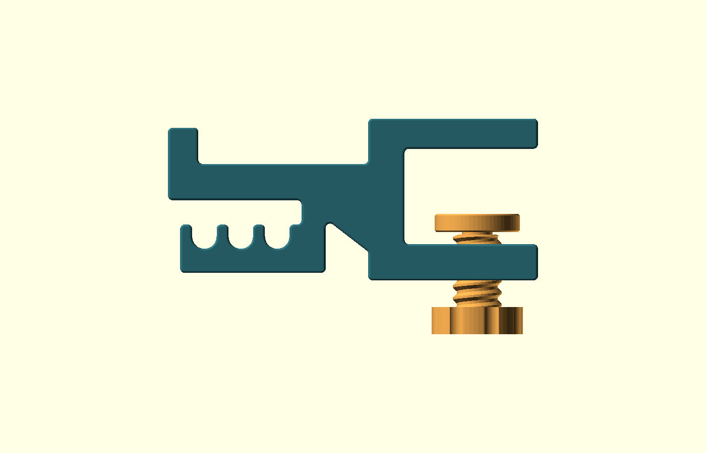

# Desk headphone hook

One original, fully printable screw-clamp design for a **21.5 mm desktop**. It has a broad saddle, a solid raised lip, an outward-opening underside rail with three cable grooves, a coarse printed screw, and a separate pressure shoe. No metal hardware is needed.



## Design choices

OpenSCAD keeps the desk thickness, saddle length, body width, and thread clearances editable. The source is self-contained and imports no geometry from the reference. FreeCAD would be a reasonable choice for a sketch-driven model with STEP output; this version prioritizes adjustable printable parts and reproducible STL exports.

The reference was mistertech's [Desk Mount Headphone Holder / Mount / Clamp](https://www.thingiverse.com/thing:2076034), supplied locally. Its README identifies rounded edges, deeper cable grooves, and 45/55 mm headband capacity. The supplied license says Creative Commons Attribution. This design acknowledges that inspiration and uses newly constructed geometry and a different clamp interface.

The new body has a diagonal brace below the saddle and a three-groove cable rail beneath it. The rail attaches at the clamp end, leaving its outer end open, away from the desk. Feed cables through that outer opening and lower them into the U-shaped grooves. The top retaining lip is solid. The screw presses into a separate shoe, spreading contact across a 28 mm disk. The shoe is loose, so hold it while mounting or removing the clamp. It is intended to reduce rubbing from the rotating screw, but friction can still turn it.



| Feature | Default |
|---|---:|
| Desk thickness | 21.5 mm |
| Clear jaw opening before shoe | 31.5 mm |
| Body width | 40 mm |
| Saddle length before corner radii | 56 mm |
| Suggested maximum headband width for first fit | 50 mm |
| Retaining lip above saddle | 12 mm |
| Underside cable grooves | Three nominal 8 mm grooves at 12 mm pitch |
| Outer cable entry | Nominal 8 mm vertical gap before edge rounding |
| Lower jaw and back thickness | 12 mm |
| Top jaw thickness | 10 mm |
| Screw major diameter / pitch | 16 mm / 4 mm |
| Screw radial / axial clearance | 0.35 mm / 0.15 mm per flank |
| Screw shaft / knob height | 28 mm / 9 mm |
| Pressure shoe | 28 mm diameter, 6 mm thick |

The flat desktop edge sits about 3 mm away from the inner back of the clamp, leaving room for the inside corner radii. Allow roughly 42 mm of clear desktop above and below the edge. A nearby apron, bevel, or rounded edge can change the fit. The nominal assembly reaches about 62 mm below the top of the desk, including its knob.

`desk_thickness` accepts 18–30 mm and regenerates the body for that thickness. This is a CAD adjustment range, not a verified range for one printed clamp. The default body has about 4 mm of insertion clearance with its shoe resting on the lower jaw.

## Files and first print

Print these two small parts first, in their exported orientations:

- `exports/thread_sample.stl`: female thread with the same sideways print axis as the body.
- `exports/screw_sample.stl`: a short screw with the same profile as the full screw.

The sample must turn fully through the threaded opening by hand without splitting the sample or forcing the knob. Remove stray strings and obvious seam burrs. If it binds, increase `thread_clearance` from 0.35 to 0.45 mm and export both the sample and the body again. If there is excessive play, try 0.25 mm. Do not scale the STLs in the slicer to tune thread fit.

After that fit check, print one each:

- `exports/body.stl`
- `exports/screw.stl`
- `exports/shoe.stl`

The other exported bodies are validation cases, not additional versions to assemble. The ZIP is a print bundle with the source, these five STLs, assembly and side-view previews, guide, and validation report. Repository validation commands require the repository checkout.

## Starting print settings

These are proposed settings, not a tested printer profile. [Prusa lists PETG for mechanical parts, holders, and clamps](https://help.prusa3d.com/article/petg_2059). Start with PETG, a 0.4 mm nozzle, 0.20 mm layers, six walls, six top/bottom layers, and 40% gyroid or cubic infill. Use 100% infill for the screw and shoe. PETG can string inside threads; dry filament and a calibrated flow rate matter here. PLA can be used for a fit sample, but long-term clamp creep and warmth still need assessment for either material.

The supplied STLs are already oriented for printing:

- Body: on its broad side, with the C-shaped outline in the bed plane. Keep this orientation to put the arm and jaw outline within the layers.
- Screw: knob flat on the bed, shaft pointing upward.
- Shoe: flat desk-contact face on the bed, blind socket facing upward.
- Female sample: flat cut face on the bed, thread axis horizontal.

Try supports off and inspect the slicer's layer preview. The horizontal threaded hole is the likely trouble spot; the sample tests that orientation. Do not fill the internal thread with automatic supports. If the top of the sample hole sags enough to block the screw, tune cooling, layer height, and bridging on the sample before printing the body. An optional brim may help the body or sample stay down.

## Assembly and use

1. Smooth any rough contact edges and clean the printed threads. Keep grit and strings off the desk-contact surfaces.
2. Thread the full screw into the bottom jaw from below, clockwise when looking up at the knob.
3. Put the shoe on the screw's smooth tip, with its flat face toward the desk. The shoe is not captured.
4. Slide the clamp over the desk edge and tighten gently by hand until it stops sliding. Further tightening can damage printed threads or mark the desk.
5. Rest the headphone band on the saddle. Feed loose cable ends into the underside rail from its outer end, away from the clamp, and lower each into a groove. These are open guides, not locking strain relief.

No padding is required to assemble the printed parts. Optional thin TPU or soft pads can protect a finish; measure their compressed thickness, set `pad_allowance` to that thickness per side, and regenerate the body. The default is zero. Printed plastic alone can still mark a delicate surface, so check it on an inconspicuous area first.

## Verification and physical trial

`validate.py` uses the repository's existing STL checker. It renders the five printable parts, two combined dimension-boundary bodies, and two clearance-boundary samples. It checks for closed, consistently wound, connected meshes without degenerate triangles, a single solid, and placement on the bed. Seven invalid parameter cases must trigger their expected assertions. Four default-assembly checks use the exported meshes to test body/screw, body/desk, body/shoe, and screw/shoe clearance. The last retracts the screw by 0.01 mm to distinguish intended tip contact from solid overlap. Three further checks sweep a 6 mm cable through the outer entry and down into each groove, using the nominal body and both size-boundary bodies. Logs, measured bounds, the source hash, and results are saved to `exports/validation.json`.

On 2026-10-19, all 23 geometry, parameter, assembly-clearance, and cable-entry checks passed for the revised source. The cable checks confirm a 6 mm circular cable envelope can enter from the outside and lower into every groove in all three tested body sizes. The default body measures 121.95 × 53.45 × 39.95 mm in its print orientation. Printed cable fit and rail strength remain unverified.

Geometry checks do not establish thread fit, print quality, load capacity, or long-term creep. Before trusting headphones to it:

1. Pass the small thread-fit test.
2. Confirm the full body fits the actual desk, including its underside and edge shape.
3. Mark the clamp position and hang a sacrificial weight equal to the headphones' measured mass for an hour over a soft surface. Check for movement, cracks, and finish marks.
4. Repeat for 24 hours, then inspect the jaw opening and threads for creep. Stop using it if it loosens or cracks.

There is no rated load yet. Keep the physical results with the filament, printer, settings, desk thickness, and test weight used.

## Edit and regenerate

Open `desk-headphone-hook.scad` in OpenSCAD. `part="assembly"` shows the mounted model; the other selectors produce individual printable parts. The translucent desk is preview-only and is never part of a printable export.

From the repository root:

```sh
python3 projects/desk-headphone-hook/validate.py --openscad /Applications/OpenSCAD-2021.01.app/Contents/MacOS/OpenSCAD
```

For one part:

```sh
/Applications/OpenSCAD-2021.01.app/Contents/MacOS/OpenSCAD \
  -D 'part="body"' -o projects/desk-headphone-hook/exports/body.stl \
  projects/desk-headphone-hook/desk-headphone-hook.scad
```

The 2021.01 application was used because the machine's `openscad` PATH entry failed at startup with a Qt processor-feature error. The default printable parts, latest print bundle and validation report are included in Git. Generated boundary-test exports and logs remain ignored and can be recreated with the commands above.
