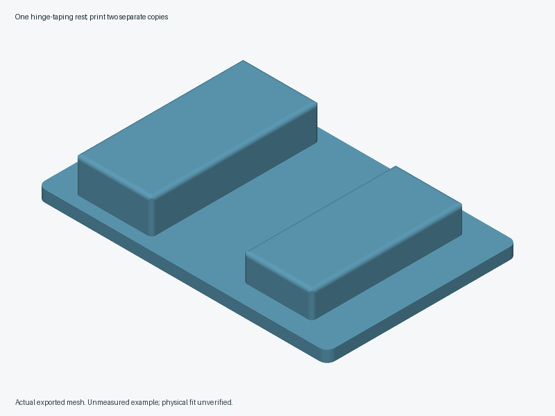

# Lift-off hinge-taping rests



Two loose identical fixed-profile rests support one compatible **flat-contact foam wing and aileron setup** while the builder follows that aircraft's tape-hinge instructions. Each rest has a flat base, two broad rounded support lands at independently specified elevations, and an open central relief above the base beneath the seam. It has no gap insert, clamp or end stop. The builder establishes the alignment and spacing; the rests only support that position.

The source exports **one connected rest**. Print it twice, as two separate loose parts. Never leave either rest on the aircraft. Lift both completely away before any fold or operation that could trap them, and count both out at completion.

All defaults are **unmeasured example dimensions**, including the unequal support elevations. They are not an aircraft profile, a universal hinge gap or a hinge angle. Utility has not been established. Compare the model's prescribed tape tabs/freehand method and simple card or wood blocks before printing.

## Geometry and dimensions

Units are millimeters. The base is centered on x/y, with z=0 on the bench. x crosses the seam and y follows it. Both lands are centered in y. Their inner envelope edges are x=`-seam_relief_width/2` and x=`seam_relief_width/2`. The relief is open at both y ends and above its z=`base_thickness` floor. The base remains continuous; there is no slot into the hinge gap.

| Parameter | Example | Meaning |
|---|---:|---|
| `base_width` / `base_length` / `base_thickness` | 76 / 50 / 3 | Flat base width across seam, length along seam and thickness |
| `minimum_floor_thickness` | 2 | Minimum retained geometric floor; no strength rating |
| `base_edge_radius` | 2 | Rounded plan-view base corners |
| `left_land_width` / `right_land_width` | 20 / 18 | Full x envelopes of the two support lands |
| `left_land_length` / `right_land_length` | 44 / 40 | Full y envelopes of the lands |
| `left_land_elevation` / `right_land_elevation` | 12 / 10 | Flat contact planes measured from the bench |
| `seam_relief_width` | 22 | Clear x distance between land envelopes; **not hinge spacing** |
| `contact_edge_radius` | 1 | Radius of all land edges, reducing each flat top by twice this value in x and y |
| `placement_margin` | 3 | Minimum base margin outside each full land envelope |
| `tape_access_width` / `tape_access_clearance` | 16 / 2 | Centered declared access envelope and extra lateral clearance per side |
| `access_height` | 5 | Minimum declared height above the floor up to the lower contact plane |
| `coupon_length` | 12 | Length of a central y slice through the same complete rest |

Example rest bounds are x=-38..38, y=-25..25, z=0..12. The left flat top is x=-30..-12, y=-21..21 at z=12; the right flat top is x=12..28, y=-19..19 at z=10. Rounded edges lie outside these flat rectangles. The coupon has x=-38..38, y=-6..6, z=0..12 and cut-flat y ends. It preserves the actual floor, land separation, x edge rounding and elevations; it does not reproduce the full rest's rounded y ends, stability or access.

Positive dimensions, floor thickness, broad flat contact areas, land/base overlap, placement margins, the declared seam/tape envelope and coupon length are asserted. These guards check geometry only. The access dimensions are a declared keep-out envelope above the floor; they do not model fingers, the foam, adhesive, tape sag, the hinge's position above its contact surfaces, or the complete removal path. Confirm all of those on a mockup.

## Source and exports

- `lift-off-hinge-taping-rests.scad`: `part="rest"` by default; `part="contact_coupon"` selects the sample.
- `contact-coupon.scad`: wrapper selecting that same-source central sample.
- `exports/`: ignored generated outputs; only its placeholder belongs in Git.

From the repository root, using a working OpenSCAD installation:

```sh
openscad --export-format asciistl \
  -o projects/lift-off-hinge-taping-rests/exports/contact-coupon.stl \
  projects/lift-off-hinge-taping-rests/contact-coupon.scad
openscad --export-format asciistl \
  -o projects/lift-off-hinge-taping-rests/exports/rest.stl \
  projects/lift-off-hinge-taping-rests/lift-off-hinge-taping-rests.scad
```

On this Mac, use `/Applications/OpenSCAD-2021.01.app/Contents/MacOS/OpenSCAD` if the `openscad` on PATH fails its processor-feature check. Regenerate outputs after changing any parameter. Inspect current exports, land heights and floor, then run the shared validator from the repository root:

```sh
python3 scripts/validate_pr16_tools.py
```

Use `--openscad PATH` to select a working installation and `--output-dir NEW-DIR` for a fresh evidence directory. The validator checks current defaults and same-source samples, fixed parameter cases, mesh topology, support elevations and central relief. Exporting a mesh does not validate fit or usefulness.

## Measurements and printing

Record the aircraft/model, foam construction, complete hinge and tape instructions, prescribed fold/spacing, tape width and adhesive keep-out. Identify robust flat bearing patches at two accessible rest positions. Measure their required elevations above a flat bench in the prescribed assembly position, available x/y contact areas, foam contour, bench flatness, full tape/finger smoothing sweep and withdrawal path. Reject a contoured wing needing a cradle, an arrangement needing different or mirrored rests, or a sequence that traps a rest or changes the prescribed hinge construction. Do not force the foam down onto the example profile.

For a 0.4 mm nozzle, PLA is a provisional cool-indoor coupon/prototype material; PETG is an alternative after contact-finish and stiffness checks. Start provisionally with 0.20 mm layers, four walls, five top/bottom layers and 30% infill. Place the flat base underside on the bed, lands upright, and start with supports disabled. Inspect slicer toolpaths for the rounded land edges and all unsupported extrusion; revise orientation or local supports if required, keeping support scars off bearing surfaces. These are unverified starting settings. No hardware or adhesive attachment is proposed; pads would change elevation/compression and are outside this version.

1. Confirm tape access and complete lift-off withdrawal with a card/wood mockup before applying adhesive. The model's instructions determine the seam, fold and gap. The rests must not set them. Stop if removal would pull on a partly bonded hinge.
2. Slice and print the coupon. Measure both land elevations, flatness, separation and actual printed edge finish. Gently use matching foam scrap to check rocking, dents, abrasion, compression and adhesive interference. The coupon alone cannot establish a full rest's stability.
3. Only after the coupon passes, inspect and print two full identical rests. On scrap, confirm the pair stays steady under normal tape application and smoothing forces, with fingers and adhesive clear. Stop for sliding, twisting, indentation, roughness, tape contamination, trapped tooling or altered hinge geometry.
4. Set a worthwhile time/retry improvement threshold and an alignment tolerance justified by the aircraft instructions or a qualified reference assembly before trials. If no justified tolerance is available, do not invent one. Compare ten matched scrap assemblies per method against prescribed tape tabs/freehand and simple blocks, alternating order with equivalent fresh foam/tape. Include retrieval, setup, application, removal and cleanup. Record total time, alignment retries, measured drift, tape waste and defects; require the agreed benefit without worse total effort or hinge outcome.
5. Inspect after twenty additional placement/removal cycles for wear, bowing, debris and new rough edges. Count both rests out before changing fold and at completion. Later model use still requires its complete independent hinge, control-travel, retention and preflight checks.

No slicer, print, foam fit, strength, friction, wear, hinge outcome, flight-readiness or measured usefulness evidence exists. See the [approved design brief](../../docs/proposals/2026-10-23-lift-off-hinge-taping-rests.md) for the original rationale and its limited evidence.
