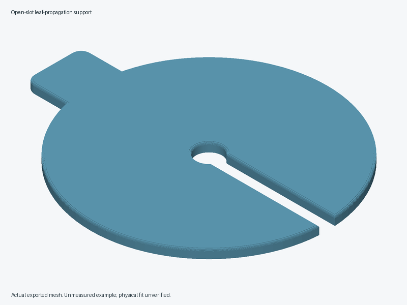

# Open-slot leaf-propagation support



An original loose plate rests across one measured jar rim. Its central opening
and continuous radial slot let the user slide it sideways around a petiole while
supporting the cutting separately. The rounded tab is opposite the slot. There
is no skirt, clamp, sealed lid or stem-gripping insert. The small coupon uses the
same source opening, full escape slot, thickness and contact-edge rounding.

**All defaults are provisional, editable and unmeasured.** No real jar, cutting,
printer or plant-contact material has been validated. Geometry and export checks
cannot establish gentle contact, stability, cleaning or practical usefulness.
See the [approved design brief](../../docs/proposals/2026-10-21-open-slot-leaf-propagation-support.md)
for the rationale and comparison with foil/paper and a rubber band.

## Measure before changing the parameters

Measure the minimum jar-mouth clearance, outer rim diameter/profile, and width
of firm coplanar bearing land. This flat plate needs broad level support on that
rim; nominal diameters do not validate a rolled, sloped or uneven rim. Measure
the petiole and needed clearance, leaf-junction shape, leaf weight distribution,
water level, immersion needs and eventual root-removal path. Establish species
suitability and cleaning routines independently. Reject a narrow neck that could
trap roots or a leaf shape that needs pinching to stay supported.

| Parameter (mm) | Example | Meaning |
| --- | ---: | --- |
| `jar_mouth_diameter` | 60 | Clear mouth diameter |
| `jar_outer_rim_diameter` | 66 | Outer envelope of level bearing rim |
| `bearing_overlap` | 2 | Minimum radial bearing width and outer overhang |
| `petiole_diameter` | 3 | Largest measured petiole section crossing the slot |
| `petiole_clearance` | 1 | Extra clearance on **each** side |
| `plate_diameter` | 76 | Round body, excluding tab |
| `plate_thickness` | 3 | Total thickness |
| `opening_diameter` | 8 | Central rounded opening |
| `slot_width` | 5 | Narrowest side-release path; never a friction fit |
| `minimum_web` | 6 | Minimum material after rounding |
| `edge_rounding` | 0.6 | Shallow stepped rounding on both faces |
| `tab_length` / `tab_width` | 12 / 18 | Tab projection beyond body and width |
| `tab_overlap` / `tab_corner_radius` | 4 / 3 | Tab/body overlap and planar corner radius |

The assertions preserve positive dimensions, petiole clearance, opening/slot
continuity, bearing width/overhang, an opening contained within the jar mouth,
straight plate-wall height, remaining web
and a joined tab. They reject impossible geometry; they do not certify a usable
jar or leaf. The slot exits along +X, and the tab lies along -X. The underside is
at Z=0; the symmetric shallow rounding leaves the full outline at mid-height.
The coupon omits the jar-bearing body and tab, so it cannot test jar stability.

## Export

Run these commands from the repository root, substituting a working OpenSCAD
binary for `openscad` if necessary:

```sh
openscad --hardwarnings -o projects/open-slot-leaf-propagation-support/exports/contact-coupon.stl projects/open-slot-leaf-propagation-support/contact-coupon.scad
openscad --hardwarnings -o projects/open-slot-leaf-propagation-support/exports/support.stl projects/open-slot-leaf-propagation-support/open-slot-leaf-propagation-support.scad
```

Run the shared repeatable checks from the repository root:

```sh
python3 scripts/validate_pr16_tools.py
```

The runner accepts `--openscad PATH` and `--output-dir NEW-DIR`. It prefers the
known working app binary when available; the PATH binary may differ. Read its
reported evidence separately from the manual checks below.

Use `-D 'parameter=value'` for measured custom dimensions. Keep all measured
parameters together when exporting coupon and support, so the contact geometry
matches. `part="support"` is the main source default; `part="contact_coupon"`
selects the coupon. The wrapper also selects that coupon. Exports stay local
and gitignored. An assertion failure must be treated as a failed export, even
if an old output file remains; remove stale output before trying a new case.

## Print and inspect

Start with the coupon. PETG is a candidate for a washable indoor prototype;
PLA is an option for a cool short fit trial. Neither material has established
plant-contact, water-exposure or cleaning suitability here. No hardware is
needed. An initial slicer setup is **0.2 mm layers, 4 walls, 25% infill**, printed
flat with Z=0 on the bed and **supports off**. These are trial settings, not
strength evidence. Both faces have six shallow offset steps approximating a
round; inspect the first layers and small underside overhangs in the slicer.
They can still print rough. Check slot clearance, outer rim contact, flatness
and top/bottom edges after printing. Reject stringing, burrs, sharp contact,
cracks or bowing; do not force delicate tissue through a rough slot. A smooth
card mockup may prove more suitable than printed texture.

## Manual acceptance and physical evidence

1. Compare foil/paper and rubber band with a smooth card mockup and a substitute
   cutting first. Check setup, removal, water changes and cleaning. Agree on a
   useful improvement before printing. Stop if stable support needs a tighter
   slot or if disposable film already works comfortably.
2. Check coupon clearance and smoothness using the measured surrogate petiole
   and leaf junction, without force. Hold the surrogate independently and slide
   it through the entire escape path. Coupon clearance does not prove full-plate
   stability or safe real-tissue contact.
3. Place the full plate and a surrogate leaf/petiole mass on the actual jar on a
   stable tray. Test actual fill levels and credible gentle handling. Reject
   tipping, falling into the mouth, slipping, unintended side escape, sharp
   bends or wetting of the supported leaf. The tab never lifts the jar.
4. Hold the cutting independently before lifting/sliding the plate away. Keep
   it safely supported elsewhere during water changes; do not pour through the
   slot. Verify eventual root removal without pulling or compressing roots.
5. Alternate ten matched handling cycles per method with the same surrogate
   and jar. Record setup/water-change/cleanup time, retries, spills, contact and
   escapes. Require the pre-agreed useful improvement without worse handling.
   Inspect twenty gentle installation/removal/cleaning cycles for roughness,
   wear, bowing, cracks and retained residue.
6. Only after mechanical handling passes, cautiously observe one expendable,
   suitable cutting through the intended propagation period. Inspect contact
   marks, water cleanliness, support changes and root removal. This does not
   establish disinfection, root health or improved propagation success.

Record actual dimensions, material, slicer settings, photos, measured outcomes
and failures separately from CAD/export checks. Slicer, print, fit, cleaning,
stability, wear and practical-use evidence remain pending.
