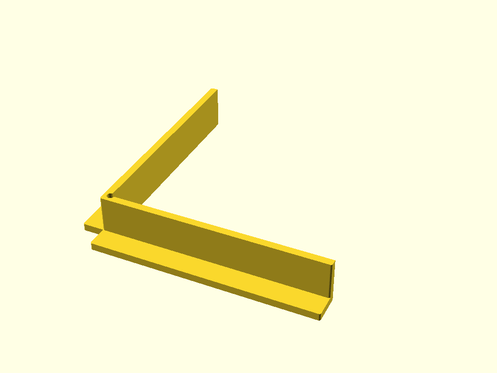

# Paper-stack corner jogger

A one-piece, bottomless L-fence prototype for squaring loose pages against two adjacent edges before gripping, removing and applying an existing binder clip. The user approved implementation of the [design brief](../../docs/proposals/2026-10-11-paper-stack-corner-jogger.md). No actual paper, stack or desk measurements have been supplied; the defaults are editable example dimensions. The first print remains optional until a cardboard trial shows a useful task.

## Geometry and parameters

All dimensions are millimeters. The desk is `z=0`; the paper area is `x>=0, y>=0`. The straight contact faces are `y=0` for `corner_relief_radius <= x <= contact_x_length`, and `x=0` for `corner_relief_radius <= y <= contact_y_length`, through `0 <= z <= wall_height`. The circular corner relief clears the intersection of the two faces. It does not round those faces or introduce a paper-support floor. Feet occupy the outside of this paper area and share volume with the walls. Both feet and walls start at `z=0`.

| Parameter | Example | Meaning |
| --- | ---: | --- |
| `contact_x_length` | 90 | End of the y=0 contact face; effective straight length is 88.5 |
| `contact_y_length` | 90 | End of the x=0 contact face; effective straight length is 88.5 |
| `wall_height` | 18 | Wall height; choose for measured maximum stack height |
| `wall_thickness` | 3 | Wall thickness and corner connecting material |
| `foot_width` | 9 | Outward foot extension beyond wall thickness |
| `foot_height` | 3 | Base thickness, less than wall height |
| `corner_relief_radius` | 1.5 | Circular clearance around the origin |
| `exterior_rounding_radius` | 0.75 | Outside corners in plan view only; zero gives square corners |

Assertions reject nonpositive dimensions, foot height reaching the wall height, overlarge rounding, relief that removes the connecting wall bridge, and arms with too little contact. Keep `corner_relief_radius + exterior_rounding_radius < wall_thickness`; each arm must extend beyond the relief by more than one wall thickness. Top edges and registration faces remain square. No lower-face chamfer or compensation is modeled: preserving contact with the lowest sheet is essential. Diagnose printed elephant-foot bulging with printer settings and a physical paper test; don't sand or compensate away the registration datum unnoticed.

## Export and printing

From the repository root:

```sh
openscad --hardwarnings -o projects/paper-stack-corner-jogger/exports/paper-stack-corner-jogger.stl projects/paper-stack-corner-jogger/paper-stack-corner-jogger.scad
```

Use the existing OpenSCAD CLI; no shared library is needed. Exports are ignored by Git. Example asymmetrical variant:

```sh
openscad --hardwarnings -D 'contact_x_length=110' -D 'contact_y_length=65' -D 'wall_height=12' -D 'foot_width=12' -o projects/paper-stack-corner-jogger/exports/asymmetric-jogger.stl projects/paper-stack-corner-jogger/paper-stack-corner-jogger.scad
```

Starting settings, pending slicer and print checks:

- PLA for a cool indoor desk; no purchased hardware. PETG is an alternative only after checking the actual environment and its surface behavior.
- Feet flat on the bed, walls upward; 0.4 mm nozzle, 0.2 mm layers, 3 perimeters, 20% infill, at least 4 top/bottom layers, supports off.
- Inspect the slice for a continuous base, full-height connected walls, no floor in the paper quadrant, and no unwanted brim or first-layer bulge at the contact faces. Place any seam away from the registration faces where the slicer allows.
- Inspect base flatness, corner buildup, straight faces, actual squareness and surface texture after printing. Check that the lowest sheet reaches both faces without climbing a ledge, catching a seam or buckling. No slicer, printed fit, strength or alignment performance is established by a valid STL.

## CAD verification

Actual mesh rendering and spatial probes are the intended verification for this fresh CAD unit; mirror unit tests of its CSG would add little evidence. Check each valid export for a closed, single connected volume and positive volume. Verify the expected extents `[-(wall_thickness+foot_width), contact_x_length]`, `[-(wall_thickness+foot_width), contact_y_length]`, `[0, wall_height]`, within tessellation tolerance.

Meaningful valid cases are the default, the asymmetric variant above, and a square-corner narrow-base variant with `contact_x_length=45`, `contact_y_length=60`, `wall_height=8`, `foot_width=4`, `foot_height=1.6`, `corner_relief_radius=1`, `exterior_rounding_radius=0`. Invalid cases should produce assertion errors: `contact_x_length=0`, `wall_height=0`, `wall_thickness=0`, `foot_width=0`, `foot_height=0`, `foot_height=18`, `corner_relief_radius=0`, `exterior_rounding_radius=-0.1`, `exterior_rounding_radius=2`, `corner_relief_radius=2.5` with default rounding, and `contact_y_length=4`.

With defaults, probe these points slightly inside/outside rather than directly on mesh boundaries:

| Probe | Expected | Purpose |
| --- | --- | --- |
| `(10, 10, 0.1)`, `(45, 45, 1.5)`, `(1, 1, 0.1)` | Empty | No inward floor or corner ledge |
| `(45, -0.1, 0.1)`, `(-0.1, 45, 0.1)` | Solid | Lowest-sheet contact reaches the desk |
| `(45, 0.1, 0.1)`, `(0.1, 45, 0.1)` | Empty | Faces stay on their reference planes |
| `(45, -0.1, 17.9)`, `(-0.1, 45, 17.9)` | Solid | Full wall height at both contact faces |
| `(-0.5, -0.5, 0.1)`, `(-0.5, 0.5, 9)` | Empty | Circular relief passes through the wall height |
| `(-2.5, -2.5, 9)` | Solid | Outer corner retains a connected wall bridge |
| `(45, -10, 1.5)`, `(-10, 45, 1.5)` | Solid | Both exterior feet exist |
| `(45, -10, 4)`, `(-10, 45, 4)` | Empty | Feet end below the contact-wall top |

Also inspect the mesh contact planes and their orthogonality over the usable lengths at both low and high z. Probe values above apply only to defaults; derive matching points from parameters for other configurations. Render/guard/probe results belong in the PR review packet; this list alone is a verification plan.

## Physical trial and useful outcomes

Measure actual sheet dimensions, cut-edge variation, thickness/curl, minimum/typical/maximum sheet counts and resulting stack heights. Record desk surface/space, grip and binder-clip handling, printer settings and material. Choose an edge-spread measurement method, its resolution and a useful improvement target before testing. The existing hand-tapping routine is the baseline. First compare a cardboard L-fence; skip the print if it adds work without benefit.

For each representative stack size, run ten paired alignment-and-transfer trials using the same sheets, alternating baseline/tool order and comparable starting edge disorder. Time the completed handling step and count retries. Measure maximum edge spread along both registered edges after gripping, removing and clipping, including representative curled sheets. CAD squareness alone does not establish aligned paper or successful transfer.

Continue only if the agreed target improves repeatedly; final edge spread must not worsen beyond measurement resolution, and retries and total handling time must not increase. Record snagging, buckling, paper marks, sliding/tipping and removal drift. Check wear and base flatness after twenty handling cycles. Stop if it requires excessive pressure or creates damage. No useful-outcome target has yet been supplied, and no cardboard, slicer, print, alignment, transfer or wear evidence exists.

The prototype deliberately omits a clip recess, tray/floor, moving stops, printed paper-size scale, scanner attachment, grip pads and powered vibration. Consider additions only after a specific failure is observed in an otherwise useful basic fence.

## Rendered preview


