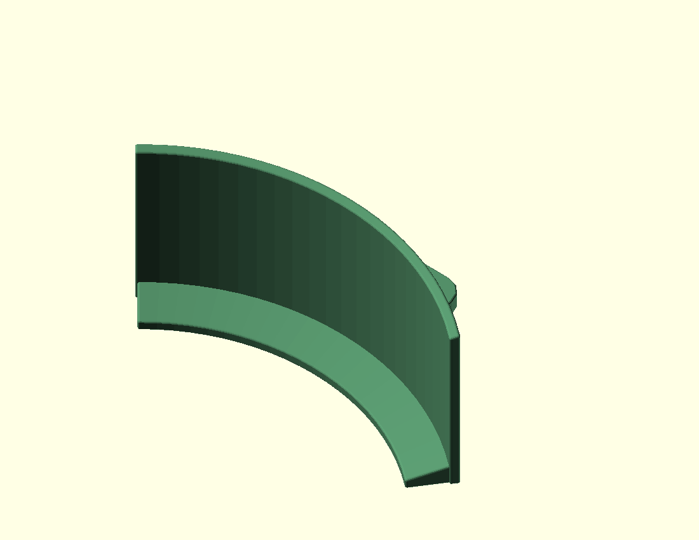
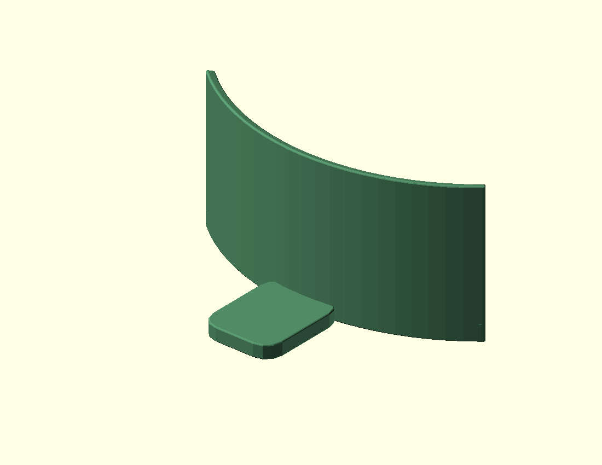

# Partial pot-rim soil shield

A hand-held curved shield for spooning potting mix around a root ball in a **nominal 6-inch pot**. Hold the outside tab throughout use. The broad ledge rests loosely on one rim sector; its upper surface slopes inward to an open drop edge. It neither clamps onto nor carries the pot.





This is an editable prototype with **unmeasured example dimensions**. Six-inch pot labels do not establish the actual inside diameter, lip shape or fit. Print the small contact coupon first. No physical fit, strength, soil-flow or usefulness result is claimed.

## Example geometry

All source dimensions are millimeters. Radius parameters are half the corresponding diameter.

| Parameter | Example | Meaning |
|---|---:|---|
| `pot_outer_radius` | 76.2 | Nominal 152.4 mm outside rim diameter |
| `pot_inner_radius` | 70.2 | Assumed 140.4 mm mouth diameter; measure it |
| `rim_clearance` | 1 | Loose radial space between outside rim and wall |
| `arc_angle` | 80° | Partial sector; most of the pot stays accessible |
| `wall_height` / `wall_thickness` | 45 / 2.8 | Wall above the sloping ledge / radial thickness |
| `ledge_thickness` | 2.8 | Thickness at inward drop edge |
| `return_reach` / `return_slope` | 4 / 15° | Reach inside mouth / upward-outward surface slope |
| `root_ball_radius` / `plant_clearance` | 62 / 3 | Example cylindrical clearance envelope / minimum gap |
| `grip_length` / `grip_width` / `grip_thickness` | 30 / 26 / 5 | External handled tab |
| `edge_radius` | 0.6 | Rounded solid edges; inspect the printed finish |
| `coupon_angle` | 16° | Same radial wall/ledge/return profile, without grip |

The root-ball radius is a declared clearance input, not a plant model. Check real roots, stems, foliage, taper and access through the full arc and removal motion. The return edge is at radius 66.2 mm in this example. Its underside is at the rim plane, z=0, and its top is above that plane. The target soil level must remain below the rim with appropriate watering headroom. The source does not determine a plant's correct planting depth.

The arc angle describes the sweep, not the exact rounded end envelope. The wall ends extend by roughly one rounding radius beyond the ledge ends to avoid coincident end-cap faces. Finished bounds must be read from the exports.

The example rim-contact footprint runs from the inward drop edge to the wall's outside radius. A flat underside cannot establish contact with a rolled, tapered, flexible or fragile rim. Reject a fit that rocks, deforms or marks the pot; do not force it or use the grip to lift the pot.

## Files and exports

- `partial-pot-rim-soil-shield.scad`: editable source; `part="shield"` or `part="contact_coupon"`.
- `contact-coupon.scad`: same-source short arc, not a separately modeled approximation.
- `validate.py`: repeatable local CAD checks and fresh evidence directory.
- `exports/`: ignored generated STLs and logs. Regenerate after every parameter change.

From the repository root:

```sh
/Applications/OpenSCAD-2021.01.app/Contents/MacOS/OpenSCAD --export-format asciistl \
  -o projects/partial-pot-rim-soil-shield/exports/contact-coupon.stl \
  projects/partial-pot-rim-soil-shield/contact-coupon.scad
/Applications/OpenSCAD-2021.01.app/Contents/MacOS/OpenSCAD --export-format asciistl \
  -o projects/partial-pot-rim-soil-shield/exports/shield.stl \
  projects/partial-pot-rim-soil-shield/partial-pot-rim-soil-shield.scad
python3 projects/partial-pot-rim-soil-shield/validate.py
```

Use `openscad` instead of the application path on a suitable installation, or pass `--openscad PATH` to the validator. On this Mac, validation prefers the working OpenSCAD 2021.01 build; the other installed build fails its processor-feature check. `--output-dir NEW_DIRECTORY` chooses a fresh export/evidence location. An existing directory is rejected rather than reusing stale exports. Missing executables, warnings/errors, unexpected assertions, invalid meshes and timed-out cases fail the command.

`validate.py` first exports the **current editable source configuration** as shield and coupon. It checks strict closed/connected/nondegenerate meshes, positive volume, bed placement and an open opposite mouth; the wrapper must match the direct coupon selector exactly. It does not compare customized dimensions with the example fixture. Source guards still run on the actual customized values.

A separate **fixed regression fixture** pins all nominal 6-inch example parameters with OpenSCAD overrides. It checks shield/coupon bounds, angular coverage including rounded end extension, sampled plant-envelope radius, grip thickness and fifteen vertical rays along the return surface. It also renders small/wide arcs, thin/shallow and steep return combinations, and a larger radius example. Seventeen intended invalid cases check the assertions; two wrong-sweep counterexamples prove that an 80° mesh is rejected as a 30° or 120° fixture. Fixed fixtures validate code behavior; their passing does not establish a customized pot fit or actual particle flow. Source hashes before/after rendering detect edits during the run.

## Printing and fitting

Measure actual outside/inside rim diameters, lip cross-section/taper, local flexibility, available arc and root-ball/foliage envelope. Edit the named source parameters, including grip/removal access. Keep radial clearance loose. The source asserts geometric ranges and overlap; it does not compensate for a particular printer or certify a rim interface.

PLA is a candidate for a brief indoor fit coupon. PETG is a candidate for the handled prototype after surface and stiffness checks. No hardware is required. Start with the flat rim-contact underside on the bed, wall upright and grip lying flat. For a 0.4 mm nozzle, 0.20 mm layers, at least four walls, five top/bottom layers and 30% infill are reasonable **unverified starting settings**; start with supports disabled in the slicer, then enable local supports if its preview shows unsupported extrusions. These are provisional settings, not a successful print profile. Inspect the actual toolpaths, layer joins and rounded lower edges. Do not infer support-free printing or strength from the preview; avoid rough support contact on the rim-resting face. Store indoors; no UV, temperature or long-term material rating exists.

1. Inspect and print the coupon. Check loose contact on a clean empty pot, free inward drop edge, absence of wobble, scratching, sharp edges, trapped grit or rim deformation.
2. Inspect and print one complete shield only after the coupon fits. Use an empty stable pot and inert root-ball surrogate over a catch tray. Confirm grip, spoon path, visible fill level, full-arc clearance and removal. A coupon cannot establish the full shield's access or stability.
3. Hold the tab while spooning mix; keep scoop weight off the shield. Use only when the pot and root ball need no supporting hand. Keep the sloping ledge above the intended fill. Stop for any sliding/tipping, trapped mix, blocked access, plant contact or breakage. Remove before final level inspection, settling and watering.
4. Compare ordinary spoon/scoop plus tray and a curved paper shield before judging usefulness. Use ten matched surrogate filling tasks per method, alternating order with the same pot, mix condition, starting surrogate and target fill. Record escaped mix and mix retained on the shield/rim separately and together as combined handling waste. Include retrieve/place/fill/remove/clean/store time, retries and final fill/headroom. Do not count retained mix as successful transfer or repeatedly repot a living plant to test it.
5. Agree on a useful waste-reduction threshold and measurement resolution before testing. Require repeated improvement without worse total time, incorrect fill or new damage/risk. Inspect after twenty gentle placement/removal/cleaning cycles. Skip the print if a paper shield or normal scoop works as well. Later use with a living plant needs its own observation.

No slicer, print, fit, flow, strength, wear, plant-health or usefulness evidence is available. See the [original design rationale](../../docs/proposals/2026-10-17-partial-pot-rim-soil-shield.md) for sources and the full physical comparison criteria.
