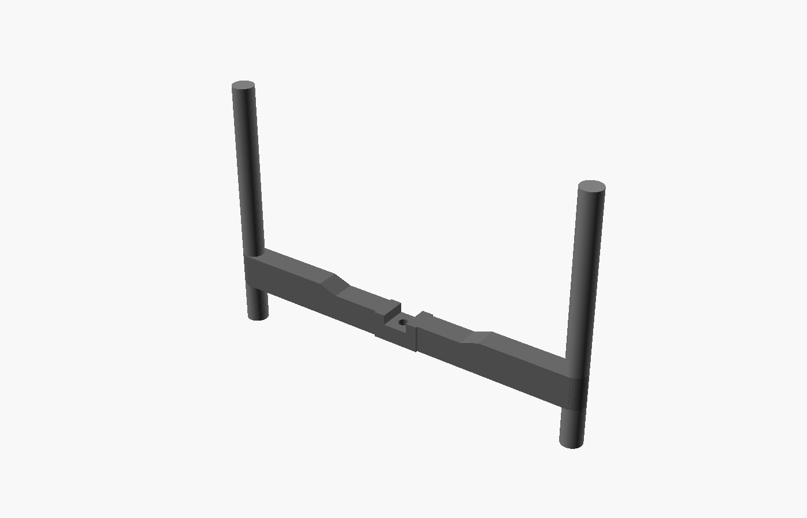
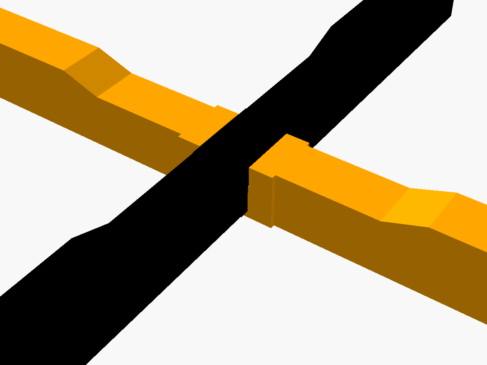

# Planter Stand Crossbar

Replacement for the missing half of an older Veradek "H" pot stand (black
injection-molded plastic, "veradek — outdoor" on the side). The surviving
half has a 30 mm notch on its underside with a screw boss in it; this
crossbar half-laps up into that notch at 90° to make a + with four legs,
and the original screw goes up from underneath into the boss.



## How it goes together

- In use, the existing half's **notched, open-ribbed edge faces the floor**
  (the logo reads right-side up that way). The short 48 mm pole stubs are
  its feet; the long ends are uprights that cradle the pot.
- This crossbar sits underneath with its notch facing **up**. Its thickened
  hub drops into the existing 30 mm notch, the existing half's 10.5 mm
  floor drops into this part's notch, and the top edges come out flush.
- The existing boss goes into a pocket in the hub. The screw goes in from
  below through a 4.5 mm clearance hole. Put a washer under the head.
- This crossbar is 4 mm deeper below the joint than the original
  (`under_extra`) so the screw has material to pull against. The feet are
  4 mm shorter to match, so all four legs stay level.



## Parts

| Part | MVP | v2 | Notes |
| --- | --- | --- | --- |
| `fit-test.stl` | 1 | – | Just the hub. Print first to check the joint. |
| `arm-long.stl` | 1 | 1 | Hub + one end, 290 mm long. Prints on the bed diagonal. |
| `arm-short.stl` | 1 | 1 | Other end, 170 mm long. |
| `foot.stl` | 2 | 2 | 44 mm leg with a 10 mm pin into the end collar. |
| `upright.stl` | – | 2 | 190 mm upright with a pin down into the collar. |

The MVP and v2 use the same arms. Each end collar has a 10.4 mm socket
through it: feet plug in from below, and uprights plug in from above. The
uprights are separate pins rather than one-piece poles because the full
270 mm pole won't print together with a 410 mm beam on a 245 mm bed.

### Hardware

- The original screw (M4 / #8 self-tapping; the boss pilot is 3.36 mm) and a washer.
- 2× M4 or #8 self-tapping pan-head screws, about 20 mm long, for the arm
  splice. Glue alone is not enough here, especially in PETG.

## Measurements used

Measured with calipers: beam thickness 24.88, beam height 24.61 (middle) /
31.90 (near poles), notch floor 10.51, hub thickness with grip ribs 25.52,
boss OD 9.91, boss hole 3.36, pole Ø23, pole top to beam 48.26, overall
width 410.

**Estimates — check these:**

- `boss_h` = 13.5: how far the boss sticks down from the notch floor. The
  pocket is deliberately deep, so getting this wrong costs only screw
  bite, not fit. Measure boss tip to notch edge and set
  `boss_h = 14.1 − that`.
- `slant_start` / `slant_end` = 75 / 95 mm from center: estimated from photos.
- `existing_notch_len` = 30: from "about 30". Measure it with calipers. The
  hub is printed 0.6 mm narrower than this value.

## Fit tolerances

- `fit_clearance` = 0.3 mm per side on the lap faces. If the fit test is
  loose, lower it to 0.15. If you have to force it, raise it to 0.4.
- Socket 10.4 mm for a 10.0 mm pin.
- The splice leaves a 0.2 mm end gap.

## Print settings

- Material: PETG or ASA (outdoors, under a damp pot). Avoid PLA: it creeps
  under a constant load and goes brittle in the sun.
- Layer height: 0.2 mm
- Walls: 4–5 perimeters. Infill: 30–40% gyroid. A full 16" pot of wet
  soil can top 30 kg.
- Orientation:
  - Arms and fit test: printed in their in-use orientation, flat bottom on
    the bed, notch facing up. Lay the long arm across the bed diagonal
    (it fits with about 10 mm to spare at each corner).
  - Feet and uprights: stand upright with the pin facing up. Uprights need
    about 205 mm of Z height. If yours is shorter, reduce `pole_len`.
- Supports: none. The splice screw counterbores are on the vertical side
  wall, so they don't need any.

## Regenerating exports

```
cd projects/planter-stand-crossbar
for p in fit_test arm_long arm_short foot upright; do
  openscad -o exports/$(echo $p | tr _ -).stl -D "part=\"$p\"" planter-stand-crossbar.scad
done
```

Interference check against a simplified model of the existing half. An
empty result ("Current top level object is empty") means the lap clears:

```
openscad -o /tmp/clash.stl -D 'show="clash"' assembly-check.scad
```
