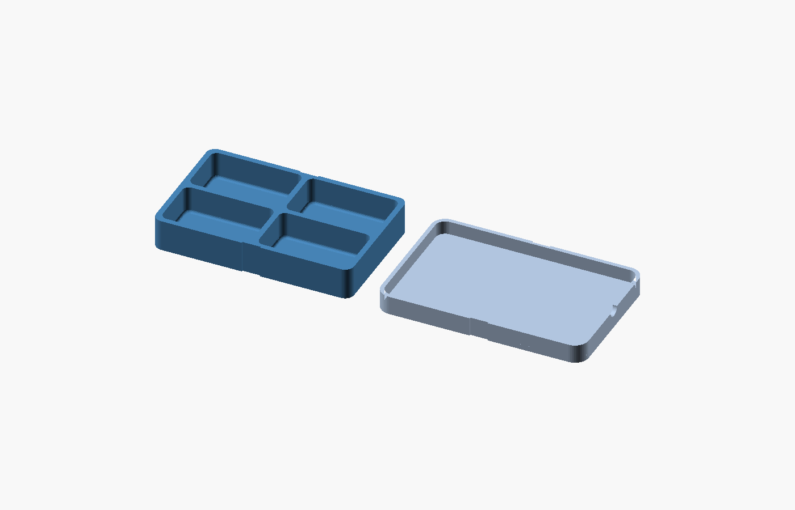

# RC hardware cassette

A four-compartment tray and lift-off lid for loose RC plane screws, washers and small nuts during bench work. An ordinary elastic band sits in shallow guides on the two long sides. Both parts have flat print beds; the lid prints with its exterior roof down and skirt up.



Sized as a compact RC bench accessory, using the E-flite Timber X 1.2m as a nominal reference. Actual hardware dimensions remain unmeasured.

## Example dimensions

| Feature | Nominal millimeters |
| --- | --- |
| Each of four well mouths | 40 × 24 |
| Well depth | 12 |
| Flat floor inside each rounded pocket | 37.6 × 21.6 before corner rounding |
| Tray exterior | 87.2 × 55.2 × 14 |
| Lid in print orientation | 91.4 × 59.4 × 8.4 |
| Closed cassette | 91.4 × 59.4 × 16.4 |
| Lid side clearance | 0.30 per side |
| Floor / walls / divider | 2.0 / 2.4 / 2.4 |
| Side band guides | 8 wide, 0.6 deep |

These are editable prototype dimensions, not measured Timber X hardware. A roughly 35 mm overall screw envelope is a reasonable first sizing target inside the 40 mm mouth; check the full head, shaft, washer and retrieval clearance together. Rounded corners and the floor fillet reduce usable space near the bottom and edges.

The [EFL38500 manual, wing assembly](https://www.horizonhobby.com/on/demandware.static/-/Sites-horizon-master/default/dw7d410af5/Manuals/EFL38500-Manual-EN.pdf) identifies two removable nylon wing bolts but does not dimension their complete envelope. No aircraft-specific bolt fit is claimed. The four wells can separate jobs or hardware types; they do not imply that the plane uses four wing bolts. Keep captive washers and retained assemblies intact.

## Parameters and lid seating

Edit the named dimensions at the top of `rc-hardware-cassette.scad`. Well dimensions drive the 2 × 2 tray, and the lid derives its outline from that tray. `lateral_clearance` is per side. The lid's flat underside nominally meets both the rim and the full-height cross divider when `closed_gap=0`; its skirt stops above the tray bottom. Parameter guards preserve at least 1.2 mm of locating overlap even with a nonzero preview gap. The recess at one short end gives fingernail access to the skirt edge.

`smallest_part_thickness=0.5` is an example for the thinnest loose part. Measure yours. The model rejects a nominal `closed_gap` at least that large, but it cannot account for printed warping, rough contact, lid flex or band stretch. No sealing or migration resistance has been demonstrated. Keep `closed_gap=0` for the first coupon and test the smallest actual washer edge-on as well as flat.

Band guides are recesses in the side faces only. The band crosses the flat exterior roof and tray bottom without a groove there. Choose an existing band that stays in the guides and holds the lid against the rim/divider without bowing it. Band size, tension and ageing remain physical checks. The band is not drawn in the preview.

## Print the interface coupons first

The `tray_coupon` and `lid_coupon` selectors crop the actual full-part modules through the front edge, both corners and the central divider. They retain the original coordinates, so the matching lid sample can be flipped onto its tray sample. Print both to test lateral clearance and mating faces before the full parts. An open cropped sample cannot prove full-box stiffness, closure or washer containment.

Starting settings, unverified in a slicer or printer:

- PLA for a cool indoor bench prototype. PETG is an alternative after checking its actual dimensional fit and stiffness. No hot-car storage assumption.
- 0.20 mm layers, 0.4 mm nozzle, four walls, five top/bottom layers, about 20% infill.
- Tray floor down; lid exterior roof down with skirt up. Coupons use those same orientations. Inspect first-layer outlines, pocket fillets, skirt, finger recess and band guides in the slicer before deciding whether supports or a brim are needed.
- Print the two coupons first. If they bind, adjust the per-side clearance and repeat. Never force the skirt or sand away the divider contact to get the lid seated.

There is no ESD, drop, flight, sealing, heat, strength or transport rating. Keep loose hardware and the cassette away from equipment openings. Use it only for already removed hardware, and follow the aircraft's normal disassembly/reassembly procedure.

## Preview, export and validate

From the repository root:

```sh
mkdir -p projects/rc-hardware-cassette/exports
openscad -o projects/rc-hardware-cassette/exports/tray.stl -D 'part="tray"' projects/rc-hardware-cassette/rc-hardware-cassette.scad
openscad -o projects/rc-hardware-cassette/exports/lid.stl -D 'part="lid"' projects/rc-hardware-cassette/rc-hardware-cassette.scad
openscad -o projects/rc-hardware-cassette/exports/tray-coupon.stl -D 'part="tray_coupon"' projects/rc-hardware-cassette/rc-hardware-cassette.scad
openscad -o projects/rc-hardware-cassette/exports/lid-coupon.stl -D 'part="lid_coupon"' projects/rc-hardware-cassette/rc-hardware-cassette.scad
python3 projects/rc-hardware-cassette/validate.py
```

The default `layout` shows both parts in print orientation. `assembly` shows the lid inverted onto the tray; preview color/transparency is not material or clearance evidence. Export the individual part selectors for printing. Generated STLs stay ignored.

The validation command needs Python 3.9+ and an OpenSCAD executable with ASCII STL export support. It was verified with OpenSCAD 2026.10.11. Use `--openscad PATH` to select a binary or `--output-dir NEW_DIRECTORY` to preserve evidence at a chosen new path. It exits nonzero for missing tools, existing output directories, renderer errors/warnings/timeouts, failed assertions or geometry mismatches. Run from a stable checkout; it checks source hashes again at the end but does not lock files.

Its 35 checks cover eight default/small/large part and coupon exports, closed connected wound meshes, positive signed volume, independent dimensions and feature rays, both previews, two measured assembly meshes, 15 invalid parameter cases, five deliberately wrong-geometry expectations, sampled full-part/coupon contact equivalence and unchanged source hashes. The wrong-geometry checks prove the checker rejects incorrect features even when a mesh is closed. They do not establish printed fit or containment. Logs and `summary.json` are retained in a fresh directory. Existing repository mesh/ray helpers are reused without modifying the completed RC stand validator.

The full-CLI failure-summary regression needs only Python:

```sh
python3 -B -m unittest discover -s projects/rc-hardware-cassette -p 'test_*.py'
```

## Physical acceptance still required

1. Measure the real hardware, smallest loose part and finger access. Compare existing bags or compartment boxes; custom CAD does not prove a useful improvement.
2. Inspect the slicer, print the coupons and verify loose fit plus full rim/divider seating. Then print one full tray and lid.
3. Over a clear catch tray, place spare hardware in each well, fit the band, carry normally and gently invert/tilt in every direction. Check thin washers edge-on. Reject escape, inter-well migration, lid lifting, band slip, wedging, hardware marks, cracks or debris.
4. Rehearse ten matched store-transfer-retrieve tasks per method in alternating order. Count all pieces before and after; record drops, mixing, retries and total handling time. If both methods have no errors, loss/mixing improvement remains unestablished. Keep fabrication and first-use setup separate from recurring time.
5. After twenty additional opening/closing/band cycles, repeat the containment checks and inspect wear, seating and permanent deformation. Limit any claim to the actual tested conditions.

No slicing, printing, actual hardware fit, band retention, washer containment, wear or usefulness trial has been performed. The first practical next step is the pair of fit coupons.
