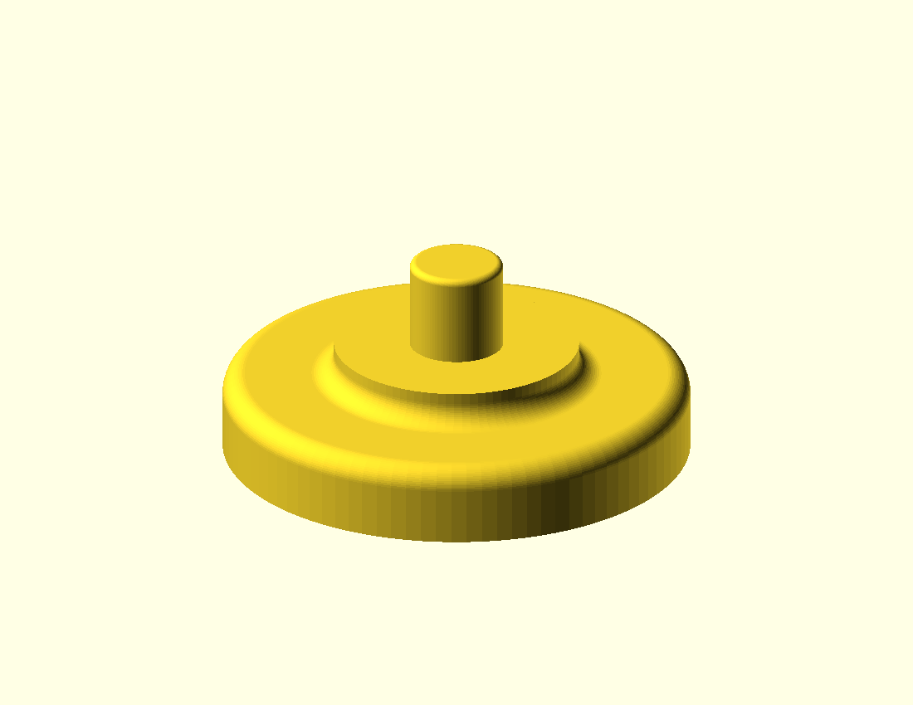

# Single-cell plug pusher

An original editable prototype for loosening one established seedling plug
through one measured tray drain hole. One coaxial solid joins a broad palm pad,
a rounded junction, a flat contact shoulder and a short blunt pin. The small
coupon shares the full pin and shoulder contact profile, omitting the palm and
its lower junction. No hardware is required.

**All defaults and the small/large cases below are UNMEASURED EXAMPLES.** No
tray fit, useful demand, load capacity, root protection, cleaning performance
or removal benefit has been established. Implementation was approved after the
[proposal](../../docs/proposals/2026-10-12-single-cell-plug-pusher.md); physical
measurements and trials remain open.



## Interface and coordinates

Units are millimeters; the axis is Z. The bed face is `z=0`. The tool's flat
shoulder contact plane is `z=palm_thickness+shoulder_thickness` (default 10).
The coupon's contact plane is `z=shoulder_thickness` (default 3). In both parts
the tip's highest flat face is exactly `pin_projection` above that plane. Its
upper rim rounds inward without adding height; flat face diameter is
`tip_diameter-2*tip_edge_radius` (default 7.2). The pin body remains 8.4 wide.

The shoulder contact diameter is `shoulder_diameter` (22). Its contact face
extends radially from the pin to the shoulder edge. The tool's solid concave
junction lies below the contact plane, reaching
`shoulder_diameter+2*junction_radius` at the palm top. Rounding also softens the
palm's outer upper edge. The coupon has a straight outer shoulder wall.
Default envelopes are 42 × 42 × 18 for the tool and 22 × 22 × 11 for the coupon.

Supply the smallest circular clearance through the real drain hole as
`hole_diameter`, including obstructions and print variation. The model assumes
a centered, firm, coplanar annular underside land between
`land_inner_diameter` and `land_outer_diameter`. It accepts only
`underside_recess_depth=0`; a recessed hole or offset land needs another
interface. Assertions require:

- Positive dimensions, radii, projection limit and minimum contact width.
- Positive diametral clearance, `hole_diameter-tip_diameter` (example 1.6).
- `pin_projection <= maximum_projection`; establish both for the actual tray.
- A remaining flat tip face and straight pin length after tip rounding.
- `land_inner_diameter >= hole_diameter`, a nonempty land, and
  `shoulder_diameter <= land_outer_diameter`.
- Radial contact overlap `(shoulder_diameter-land_inner_diameter)/2 >=
  minimum_contact_width` (example 5 >= 2).
- `shoulder_thickness > junction_radius`, `palm_thickness > junction_radius`
  and `palm_diameter > shoulder_diameter+4*junction_radius` so the fillet leaves
  a solid shoulder and distinct palm top.
- `part="tool"` or `part="contact_coupon"` only. The wrapper selects the latter.

These are geometric conditions. `maximum_projection` and
`minimum_contact_width` are inputs, not universal safe travel or strength
limits. Firm land contact defines projection only while the tray remains
undeformed. It does not limit applied force. Reject ribs, recesses, fragile
plastic, insufficient hand clearance or surfaces that contact the palm/junction
before the shoulder seats. A circular input does not establish compatibility
with an irregular hole.

## Regenerate and check

Run from the repository root with OpenSCAD on PATH. On this Mac the executable
is `/Applications/OpenSCAD-2021.01.app/Contents/MacOS/OpenSCAD`; use that path in
place of `openscad` if needed. Exports are gitignored; commit editable sources,
not STL files.

```sh
openscad --export-format asciistl -o projects/single-cell-plug-pusher/exports/tool.stl projects/single-cell-plug-pusher/single-cell-plug-pusher.scad
openscad --export-format asciistl -o projects/single-cell-plug-pusher/exports/contact-coupon.stl projects/single-cell-plug-pusher/contact-coupon.scad
openscad --export-format asciistl -D 'part="contact_coupon"' -o projects/single-cell-plug-pusher/exports/selector-coupon.stl projects/single-cell-plug-pusher/single-cell-plug-pusher.scad
openscad --render --imgsize=1100,850 --viewall --autocenter --projection=o --camera=0,0,0,65,0,35,100 -o projects/single-cell-plug-pusher/preview.png projects/single-cell-plug-pusher/single-cell-plug-pusher.scad
```

Small UNMEASURED EXAMPLE: tool 30 × 30 × 11; coupon 16 × 16 × 6. Change the source
filename to `contact-coupon.scad` to export the same interface without the palm.

```sh
openscad --export-format asciistl -D 'hole_diameter=7' -D 'tip_diameter=5.8' -D 'tip_edge_radius=0.4' -D 'pin_projection=4' -D 'maximum_projection=5' -D 'shoulder_diameter=16' -D 'shoulder_thickness=2' -D 'palm_diameter=30' -D 'palm_thickness=5' -D 'junction_radius=1' -D 'land_inner_diameter=8' -D 'land_outer_diameter=18' -o projects/single-cell-plug-pusher/exports/small-tool.stl projects/single-cell-plug-pusher/single-cell-plug-pusher.scad
```

Large UNMEASURED EXAMPLE: tool 52 × 52 × 23; coupon 28 × 28 × 14.

```sh
openscad --export-format asciistl -D 'hole_diameter=14' -D 'tip_diameter=12' -D 'tip_edge_radius=1' -D 'pin_projection=10' -D 'maximum_projection=12' -D 'shoulder_diameter=28' -D 'shoulder_thickness=4' -D 'palm_diameter=52' -D 'palm_thickness=9' -D 'junction_radius=3' -D 'land_inner_diameter=16' -D 'land_outer_diameter=30' -D 'minimum_contact_width=3' -o projects/single-cell-plug-pusher/exports/large-tool.stl projects/single-cell-plug-pusher/single-cell-plug-pusher.scad
```

For an intended rejection, export CSG and inspect the diagnostic for the named
assertion; OpenSCAD 2021.01 can exit zero despite a CSG assertion failure.

```sh
openscad -D 'tip_diameter=10' -o projects/single-cell-plug-pusher/exports/interference.csg projects/single-cell-plug-pusher/single-cell-plug-pusher.scad
```

Focused CAD checks cover the default, selector coupon, small and large parts
and the exact projection limit (`pin_projection=10`). Each STL must have finite,
nondegenerate, consistently wound triangles and one closed connected surface,
with the stated bounds. Intended rejected examples, changing one default at a
time, are:

| Definition | Expected assertion |
| --- | --- |
| `part="bad"` | Unknown part selector |
| `hole_diameter=0`, `tip_diameter=0`, `shoulder_thickness=-1`, `minimum_contact_width=0`, or `junction_radius=0` | Dimensions must be positive |
| `tip_diameter=10` | Positive diametral clearance |
| `pin_projection=10.1` | Exceeds measured maximum projection |
| `underside_recess_depth=1` or `-1` | Recessed or offset contact land |
| `land_inner_diameter=24` or `9`, `land_outer_diameter=21`, or `minimum_contact_width=5.1` | Firm annular contact land |
| `shoulder_thickness=2`, `palm_thickness=2`, or `palm_diameter=30` | Junction rounding |
| `tip_edge_radius=4.2` | Flat blunt face and straight pin length |
| `tip_edge_radius=1` with `pin_projection=1` | Flat blunt face and straight pin length |

Conventional unit tests are deliberately omitted for this standalone CAD
surface. Replacement evidence uses real OpenSCAD exports, actual mesh and
dimension checks, and intended assertion diagnostics; no duplicate Python
validator tests or production test hooks were added. CAD checks establish
geometry only. Slicer, print, fit and use gates below remain required.

## Print and physical gates

Start with the coupon, flat base down and pin up. Use the same orientation for
the tool: palm's flat bed face down, pin up. Starting slicer settings for these
examples are 0.2 mm layers, four perimeters and 40% infill. No supports are
expected in that orientation, subject to slicer inspection of the rounded
surfaces. PETG is a candidate for a handling prototype; PLA may be used for a
cool, dry fit coupon. Neither material has validated cleaning, heat, outdoor
durability or load evidence here. Confirm printer/material settings, inspect
the junction's layer structure, and remove rough contact edges without changing
the measured interface. Infill settings do not establish strength.

1. Establish a real recurring task and tray make/model, material and condition.
   Compare ordinary flexing/hand removal and a suitably blunt dowel first.
   Record hole shape/access, cell depth/taper, underside land/ribs/recess,
   useful travel, permissible projection and hand clearance. Existing hand or
   bench support must keep the tray stable and alignment visible; reject if a
   new support fixture would be needed.
2. Print the measured coupon. Require unforced entry/withdrawal without scraping
   and broad shoulder seating on the intended firm land. Check that the lower
   body does not interfere before seating. This checks the interface only.
3. Print one measured tool and try spare cells/plugs gently, supporting the tray.
   Stop on resistance or tray bending. Support and lift the plug from above;
   do not force the tool through. Record tray deflection, puncture, cracking,
   plug breakup and visible root damage. Reject a narrow spike solution if the
   hole cannot admit an adequately broad blunt tip.
4. Compare at least ten matched removals per method, alternating methods under
   recorded crop, root establishment, growing medium and moisture conditions.
   Agree on an improvement target and observation resolution first. Record
   time, attempts, breakup, visible root damage and tray deformation. Accept
   only if the chosen outcome improves without worsening others; inspection
   cannot establish later plant survival or transplant success.
5. Record twenty insertion/removal cycles using the same support, projection,
   plug condition, push direction and effort protocol. Measure effort if an
   appropriate instrument exists; otherwise report qualitative handling only.
   Inspect pin alignment, shoulder/junction wear, cracks and tray marks. Reject
   slipping shoulders, gouging tips, tray distortion or an equally useful
   baseline. Clean and dry using the chosen process, then check retained soil
   and wear; no disinfection or chemical compatibility claim is established.
