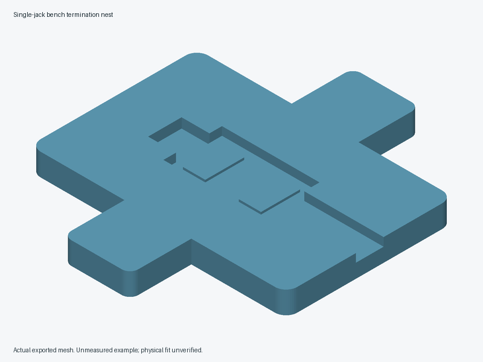

# Single-jack bench termination nest



An original shallow nest for **one measured jack housing**, with two broad raised bearing lands, a continuous backing floor, an edge-open cable channel at +X, a deeper latch relief at -X and two external bench-clamp ears at +/-Y. The sides locate loosely. The fixture has no snap fit or latch restraint. It is not a printed impact tool or protective equipment.

**All interface defaults are unmeasured example geometry.** No actual jack, punch tool, clamp or useful repeat task has been confirmed. This first model is a rectangular-envelope prototype; it does not establish fit, universal keystone compatibility, safe tool loading or termination quality. Compare the jack manufacturer's recommended holder/support method and a wood support before printing. Reject this design if the housing has steps/protrusions that the rectangular recess cannot support, the required tool sweep intersects the fixture or the real task does not improve with bench setup. Do not scale it globally to fit.

## Geometry and dimensions

Units are millimeters. Origin is at the base center on the bed, Z=0. X follows the jack/cable; Y crosses the jack. The default base is 92 x 60 x 8; the ears extend total Y bounds to 104. The recess is 35 x 21, representing a 34 x 20 housing plus 0.5 clearance **per side**. Its continuous floor is Z=5; two 8 x 14 lands centered at X=-10 and +10 provide bearing faces at Z=5.8. The housing must have robust, nonfunctional support surfaces covering both complete lands. Neither the contacts nor latch may bear load. Recess walls rise 2.2 above the bearing faces; actual terminals, labels, mating opening, latch, wire dress and blade must remain exposed.

The +X cable channel is 10 wide, open through the edge, with floor at Z=5. The -X relief is 12 wide and reaches 10 beyond the recess at a floor of Z=4.5. It is an unmeasured latch keep-out pocket; its end wall must never become a latch stop. Increase the measured relief as needed within the structural guards; reject this geometry if the resulting arrangement cannot clear the whole latch/mating opening. Two clamp ears offer rounded external flats with an 8 mm nominal overlap; clamping must not bow the base. The clamps act only on the ears and must not squeeze or retain the jack.

The contact coupon crops the **same complete nest geometry** to 50 x 32 x 8, retaining both lands, the complete recess width and edge-open cable/relief stubs. It omits the clamp ears and most of the base. It can check contact and removal but cannot establish clamping, stability, complete cable bend space or tool-load behavior.

Parameters at the top of the source control the housing, clearance, floor/recess, raised lands, latch relief, cable channel, ears, clamp pad envelope, coupon and lowest tool working envelope. Structural minima are conservative modeling guards, not load ratings. Assertions preserve at least 3 mm backing floor, 4 mm walls/straight ear joins, 6 x 12 mm bearing faces and 1 mm modeled tool gap. The modeled tool envelope is the *lowest point of the entire swept tool/hand approach*, measured above the bearing face. Its bottom must exceed the fixture top by at least the gap; length/width record the measured envelope only and do not simulate movement. Review the actual sweep separately. The illustrative tool envelope is 40 x 30 with bottom 8 above the bearing face.

## Measure before selecting production dimensions

Record exact jack and tool models, manufacturer support/termination instructions, permitted IDC reuse and measurement resolution. Measure the jack housing's supported footprint/steps, robust bearing faces, full latch and mating/contact keep-outs, conductor slots/labels, dressing access, blade orientations and complete tool/hand sweep. Measure cable/boot diameter, required bend space/slack and a straight lift-out path without pulling wires. Record the bench and both clamp jaws/pads, including articulation, operating handles and pad clearance from the jack/cable. Pads must fit fully on the external ear flats with margin. If any support would press a latch, contact, hollow housing area or fragile protrusion, stop and revise the selected-model design.

Choose a worthwhile improvement target and the existing support baseline before testing. Unknown measurements must not be represented as hardware-verified values. CAD approval permits development; it does not waive these physical checks.

## Export and digital checks

From the repository root, use an installed OpenSCAD CLI:

```sh
openscad -o projects/single-jack-bench-termination-nest/exports/contact-coupon.stl projects/single-jack-bench-termination-nest/contact-coupon.scad
openscad -o projects/single-jack-bench-termination-nest/exports/nest.stl projects/single-jack-bench-termination-nest/single-jack-bench-termination-nest.scad
# Example clearance sensitivity only; this is not a measured jack fit.
openscad -D 'recess_clearance=0.8' -o projects/single-jack-bench-termination-nest/exports/nest-loose.stl projects/single-jack-bench-termination-nest/single-jack-bench-termination-nest.scad
```

Run the shared repeatable digital validation from the repository root with `python3 scripts/validate_pr16_tools.py`. Use `--openscad /absolute/path/to/OpenSCAD` to select a CLI or `--output-dir /absolute/path/to/new-directory` to retain artifacts. The validation checks fixed parameter fixtures and does not replace measured hardware trials.

The wrapper selects `part="contact_coupon"` in the main source. Command-line `-D 'part="contact_coupon"'` also selects it. Exports are ignored; commit source and measurement records rather than generated STLs. Inspect the console for `ERROR: Assertion`: OpenSCAD versions can report an assertion without a failing process status. Require a fresh, nonempty export and inspect errors; never accept a stale STL. Check connected, closed, consistently wound, finite, nondegenerate positive-volume meshes and expected bounds. Inspect floor/contact heights, relief and channel openings, broad supports, ear joins and tool clearance as geometry, not only manifoldness. Exercise meaningful valid and invalid parameter cases. Digital checks do not establish physical performance.

## Provisional printing and validation

For an initial unloaded fit coupon, PLA is a candidate. For a full bench prototype, PETG is a candidate starting point at **0.2 mm layers, 5 walls and 40% infill**, flat Z=0 face on the bed, lands/recess upward, no supports intended. These are provisional settings without established impact performance. Check the actual slicer toolpaths: continuous floor, solid bearing lands, ear joins, adhesion, no voids/bridging at contacts, flatness and clearance. Record printer/nozzle, filament, orientation and slicer settings. Do not infer strength from molded commercial stands.

1. Print the contact coupon. Place a disconnected spare jack without force. Inspect both full bearing contacts, rocking, housing marks, all keep-outs, wire dress and easy straight lift-out. Stop on latch stress, tight removal or unsupported housing.
2. Print the full fixture only after the coupon passes. On a clear bench, perform **unloaded** clamp/flatness, cable bend/exit, jack stability and every tool approach/blade-orientation check. Keep hands clear of the tool path. Reject any need to squeeze the housing or use its latch as a stop.
3. Separately perform controlled tool-load trials at every required termination position with new disconnected spare hardware and the actual tool's prescribed settings/instructions. Stop on motion, tilt/ejection, clamp interference, cracking, permanent set, housing/IDC damage or tool contact with the fixture. A loose nest is unsuitable if the prescribed punch directions require additional jack restraint. Do not use service cabling until this arrangement passes under the demonstrated conditions.
4. Compare ten matched terminations per method, alternating order and using equivalent new spare jacks/cable. Do not repunch an IDC unless expressly permitted. Record complete setup/dress/terminate/remove/cleanup time, retries, waste and defects. Require the chosen improvement without worse total time, wire dressing, quality or handling. Follow the maker's appropriate inspection/test procedure; wire-map alone is not category certification.
5. Inspect after twenty additional placement/removal and clamp cycles for wear, bowing and debris. Log actual loaded terminations separately; unloaded cycling proves no impact life.

No slicing, printed fit, clamp stability, strength/impact, electrical performance, durability or practical benefit is established by this source. Keep each evidence stage separate and record failures as well as passes.
