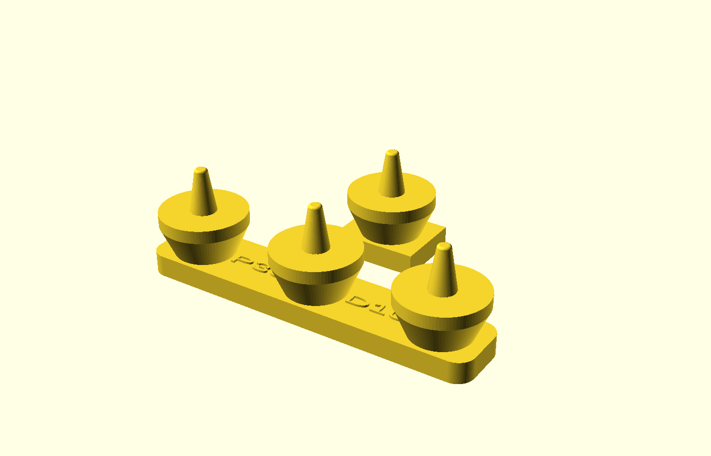

# Three-pin sowing dibber

One original parametric print makes three planting depressions in prepared, level, loose soil. Three broad shoulders set nominal penetration; a rounded spine joins the pins and carries raised pitch/depth labels. The same source exports a one-pin coupon for the first media trial.



## Example dimensions and use

The defaults are examples, not settings for any particular crop:

| Setting | Default | Meaning |
|---|---:|---|
| `pitch` | 30 mm | Pin center spacing within a group of three |
| `nominal_depth` | 10 mm | Shoulder contact plane to flat tip |
| `pin_base_diameter` / `tip_diameter` | 6 / 3 mm | Tapered pin base and nose before rim rounding |
| `tip_round` | 0.6 mm | Nose rim radius; flat nose remains 1.8 mm wide |
| `shoulder_diameter` / `shoulder_thickness` | 20 / 3 mm | Bearing face and thickness |
| `spine_width` / `spine_thickness` | 16 / 5 mm | Rounded grip spine |
| `grip_clearance` | 10 mm | Spine top below the shoulder contact plane |

The full default print is approximately 80 × 20 × 25 mm; the coupon is 20 × 20 × 25 mm. `P30` means 30 mm pitch and `D10` means 10 mm nominal penetration. Edit the top-of-file dimensions before exporting. Pin count is fixed at three. Labels follow pitch/depth automatically and sit above the spine's print-bed face.

For use, invert the print so the pins point down. Select the actual crop's packet spacing/depth, prepare the media as instructed and gently press only where all three shoulders can meet the surface. Lift straight out. A ruler or string still locates successive groups and rows. Do not force the tool through firm, stony or root-filled soil or push a high shoulder down to match an uneven surface.

Rigid shoulders cannot independently follow unequal soil heights. Sinking shoulders, tilt, compaction, sticking and hole collapse change actual hole depth. Seed placement, covering and settling change final burial depth. Surface sowing and continuous drills need other methods. No improvement in germination or soil performance is established.

## Export and local validation

From the repository root, with OpenSCAD installed:

```sh
mkdir -p projects/three-pin-sowing-dibber/exports
openscad --export-format asciistl -o projects/three-pin-sowing-dibber/exports/dibber.stl -D 'part="dibber"' projects/three-pin-sowing-dibber/three-pin-sowing-dibber.scad
openscad --export-format asciistl -o projects/three-pin-sowing-dibber/exports/contact-coupon.stl -D 'part="contact_coupon"' projects/three-pin-sowing-dibber/three-pin-sowing-dibber.scad
python3 projects/three-pin-sowing-dibber/validate.py
```

Requires Python 3.9+ and an OpenSCAD CLI with ASCII STL export. Use `--openscad /absolute/path/to/OpenSCAD` to select an executable. On this Mac the native executable is `/Applications/OpenSCAD.app/Contents/MacOS/OpenSCAD`. Generated STL files are ignored.

The validator exports the actual defaults plus small, large and minimum-cleaning-gap fixtures, each as a full dibber and coupon. It checks finite nondegenerate triangles, closed two-face edges, consistent winding, connectedness, positive volume, bounds and surface rays through each pin, taper, rounded flat nose, shoulders, necks, spine, raised-label presence and cleaning gaps. It directly measures X-axis pin centers and reports the adjacent pitches. It exercises invalid dimensions/selectors and proves rejection of actual manifold mutants with a missing/short/shifted center pin, bridged shoulders, missing labels or an unrounded tip. It compares full/coupon contact surfaces and records source hashes. Unchanged shared renderer/mesh helpers are reused.

It exits zero only when every case passes, retaining per-case logs, exports and `summary.json` in a fresh temporary directory. `--output-dir /path/that/does/not/exist` chooses the evidence location. Missing executables, existing output directories, renderer errors/warnings, malformed meshes, missing exports, incorrect features and 180-second per-export timeouts fail. A renderer's zero exit does not conceal its error diagnostics. Run from a stable checkout without editing sources during validation.

The focused failure-report regression needs only Python:

```sh
python3 projects/three-pin-sowing-dibber/test_validate.py
```

## Print starting point

PETG is a candidate for a temporary soil/plain-water prototype; PLA may serve an indoor coupon. No purchased hardware is intended. Begin with a 0.4 mm nozzle, 0.2 mm layers, four walls and 35% infill as unverified starting settings. Print the flat spine on the bed with tips upward. Inspect the sloping necks, shoulder overhangs, nose finish, supports and layer loading in the slicer before printing; support-free printing is not established by the mesh. Avoid supports on working faces where practical and inspect/remove any sharp remnants. Dry and store indoors after compatible cleaning. Material choice alone establishes no strength, weather resistance, cleanability or chemical compatibility.

## Physical acceptance still required

1. Identify the actual crop/packet, batch size, individual-hole spacing/depth, media texture/moisture, level working area, rim/divider/plant clearance and printer variation. Agree useful depth/pitch tolerances and a minimum whole-task time benefit. Compare a marked pencil and ruler, three smooth dowels in a wood block and an available commercial multi-dibber. Stop if an ordinary method is adequate.
2. Slice and print the one-pin coupon first. In sacrificial media at the intended preparation/moisture, check gentle entry, sinking, collapse, withdrawal and remaining hole depth. Measure from undisturbed local soil, not the compressed shoulder dent. Reject force, sticking, excess compaction, tearing, marks/debris, cracks or bending. Follow the required garden-tool sanitation procedure; do not use this print if it cannot tolerate that procedure.
3. Print the full bar only after the coupon trial. Check all three holes and gaps between groups/rows in fresh level patches. Coupon success does not prove equal three-pin penetration. Reject drag, trapped soil, dimensional errors or needed force.
4. Compare ten matched fresh batches per method in alternating order, using the same target count, settings and media conditions. Record acceptable holes, depth/pitch errors, rework and complete retrieve/mark/press/place-seeds/cover/clean/store time, including ruler alignment between groups. Include fabrication/fitting effort separately and retain first-use total against actual sowing frequency. Accept only the agreed time benefit without worse hole quality or more compaction. Hole geometry does not establish final burial depth or germination.
5. Inspect after twenty additional press/withdraw/cleaning cycles for tip wear, cracks, debris, lodged media and dimensional drift. Slicing, prints, actual fit, soil depth, strength, cleaning, wear and usefulness remain unverified.

The approved brief and its [RHS and commercial prior-art references](../../docs/proposals/2026-11-02-three-pin-sowing-dibber.md) explain the task and alternatives. This CAD implements that bounded prototype; it does not establish an actual owner sowing problem or a validated advantage.
